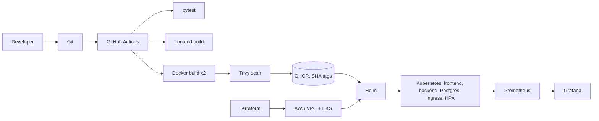

# PlaceTrack: DevOps Capstone

**Raghavendra, 24BCS10250**

PlaceTrack is a small web app for tracking job and internship applications. You add a company and a role and move it through applied, interview, offer or rejected. The app is simple on purpose. The work in this project is everything around it: tests, containers, a CI pipeline with a security scan, Terraform for AWS, Kubernetes with Helm, and monitoring.



| Layer | Technology |
|---|---|
| Frontend | React 18, Vite, nginx |
| Backend | FastAPI, SQLAlchemy 2, Alembic |
| Database | PostgreSQL 16 |
| Tests | pytest (SQLite test database) |
| Containers | Docker, Docker Compose |
| CI/CD | GitHub Actions, GHCR, Trivy |
| Infrastructure | Terraform: VPC and EKS in `ap-south-1` |
| Orchestration | Kubernetes, Helm, nginx Ingress, HPA |
| Monitoring | Prometheus, Grafana, ServiceMonitor |

## Repository layout

```text
backend/            FastAPI app, Alembic migration, tests, Dockerfile
frontend/           React app, nginx config, multi-stage Dockerfile
docker-compose.yml  postgres + backend + frontend
k8s/                namespace, EKS storage class
helm/placetrack/    Helm chart
terraform/          VPC (2 public subnets) and EKS
monitoring/         Prometheus/Grafana values, dashboard, install script
troubleshooting/    two broken manifests and the fixes
scripts/            deploy.sh, load-test.sh
.github/workflows/  CI/CD pipeline
docs/               presentation, speaker script, demo script
images/             screenshots used below
```

## M1: Application

| Method | Path | Purpose |
|---|---|---|
| GET | `/api/jobs` (`?status=`) | list applications |
| POST | `/api/jobs` | create |
| GET, PUT, DELETE | `/api/jobs/{id}` | read, replace, delete |
| GET | `/api/jobs/stats` | count per status |
| GET | `/health`, `/ready`, `/metrics` | liveness, readiness (checks the database), Prometheus metrics |

The `jobs` table is created by the Alembic migration `backend/alembic/versions/0001_create_jobs.py`. Swagger UI is at `/docs`.

The dashboard under Docker Compose (`http://localhost:3000`) and at phone width:


## M2: Tests

There are 16 pytest cases. They cover all the endpoints, `/health`, `/ready` (including a 503 when the database is down), `/metrics`, validation errors and 404s. The tests use an in-memory SQLite database through FastAPI's dependency override, so they never touch Postgres. The config is `backend/pytest.ini`.

```bash
cd backend && python3.12 -m venv .venv && source .venv/bin/activate
pip install -r requirements-dev.txt
pytest -v
```


## M3: Git

Small commits with clear messages. `.gitignore` covers `.env`, `__pycache__`, `node_modules`, `.venv`, Terraform state and `*.tfvars`. Gitleaks finds nothing in the history.


## M4: Docker

* `backend/Dockerfile`: `python:3.12-slim`, runs as user 10001.
* `frontend/Dockerfile`: multi-stage. Node builds the bundle, `nginx-unprivileged` serves it as user 101.
* `docker-compose.yml`: postgres with a healthcheck, the backend (runs `alembic upgrade head` first) and the frontend on port 3000.

```bash
docker compose up --build
```


## M5: CI/CD

`.github/workflows/ci-cd.yml` runs on every push to `main` and on pull requests:

1. `test`: installs the backend and runs `pytest -v`. A failing test stops the pipeline.
2. `frontend`: `npm ci && npm run build`.
3. `image` (backend and frontend): builds the image, scans it with Trivy, logs in to GHCR and pushes `ghcr.io/raghavendra1729-cell/placetrack-<service>:<commit SHA>`. Images are tagged with the commit SHA, never `latest`.

The actions are pinned to commit SHAs and only the `image` job can write packages.

Status: the repository is not pushed yet, so there is no Actions run link or GHCR page. I ran the test, build and scan steps locally (pytest, `npm run build`, `docker build`, Trivy). The login and push steps need GitHub. The run link and a GHCR screenshot go here after the first push.

## M6: Trivy

Trivy scans both images and fails the job on fixable HIGH or CRITICAL findings (`severity: HIGH,CRITICAL`, `ignore-unfixed: true`, `exit-code: 1`).

My first scan failed. The backend had 3 HIGH findings in Starlette 0.41.3, which came with the FastAPI version I had pinned (for example CVE-2025-62727, a denial of service through crafted `Range` headers). The frontend image, built on an old Alpine nginx, had 40 HIGH and 2 CRITICAL findings in system libraries such as OpenSSL (CVE-2026-31789, a heap buffer overflow on 32-bit systems), libexpat and libxml2.

I upgraded FastAPI (which brings Starlette 1.7.0) and the other Python pins, and moved the frontend to `nginx-unprivileged:1.30.5-alpine`. Both images now scan clean with exit code 0.


A clean scan means no fixable HIGH or CRITICAL vulnerability is in the image at scan time, which is why it runs on every build.

## M7: Terraform

`terraform/` creates a VPC (`10.0.0.0/16`) with two public subnets in two availability zones and an EKS cluster with a managed node group of two `t3.medium` nodes. There is no NAT gateway, to keep the cost down. The EBS CSI driver has its own IAM role so only its service account gets volume permissions. The cluster API is limited to my IP through the required variable `api_access_cidrs`, kept in the git-ignored `terraform.tfvars`. Terraform uses the AWS CLI profile, so no credentials are in the repository.

```bash
cd terraform
terraform init
terraform fmt -check && terraform validate
terraform plan -out=tfplan      # Plan: 53 to add, 0 to change, 0 to destroy
```


Status: `init`, `validate` and `plan` are done. `terraform apply` creates paid resources and has not been run, so the AWS Console screenshots and the `terraform destroy` output are still to add. Run `terraform destroy` as soon as they are taken.

## M8: Kubernetes and Helm

The chart in `helm/placetrack` deploys, into the `placetrack` namespace:

* backend and frontend Deployments with 2 replicas each, running as non-root, with readiness and liveness probes
* ClusterIP Services for both
* an Ingress that sends `/` to the frontend and `/api` to the backend
* a Postgres StatefulSet with a volume, a generated database Secret, and a post-install Job that runs the Alembic migration
* an HPA for the backend (2 to 4 pods at 60% CPU)

### Deploy on minikube

```bash
minikube start -p placetrack --driver=docker --cpus=4 --memory=5500
minikube -p placetrack addons enable ingress
minikube -p placetrack addons enable metrics-server
docker build -t ghcr.io/raghavendra1729-cell/placetrack-backend:local backend
docker build -t ghcr.io/raghavendra1729-cell/placetrack-frontend:local frontend
minikube -p placetrack image load ghcr.io/raghavendra1729-cell/placetrack-backend:local ghcr.io/raghavendra1729-cell/placetrack-frontend:local
kubectl apply -f k8s/namespace.yaml
helm upgrade --install placetrack helm/placetrack -n placetrack --set ingress.host= --wait --timeout 300s
kubectl -n ingress-nginx port-forward svc/ingress-nginx-controller 8080:80    # open http://localhost:8080
```

`--set ingress.host=` makes the Ingress match any host so `localhost` works. The database Secret and the Postgres volume both survive `helm uninstall`. To start from scratch also run `kubectl -n placetrack delete secret placetrack-db pvc data-placetrack-postgres-0`.

### Deploy on EKS (after `terraform apply`)

The images must be pushed by CI and the GHCR packages set to Public.

```bash
aws eks update-kubeconfig --region ap-south-1 --name placetrack
kubectl apply -f k8s/storageclass-ebs-gp3.yaml
helm upgrade --install ingress-nginx ingress-nginx --repo https://kubernetes.github.io/ingress-nginx -n ingress-nginx --create-namespace --wait
helm upgrade --install metrics-server metrics-server --repo https://kubernetes-sigs.github.io/metrics-server/ -n kube-system --wait
scripts/deploy.sh <commit-sha> --set image.pullPolicy=Always --set postgres.storageClass=ebs-gp3
kubectl -n ingress-nginx get svc ingress-nginx-controller    # EXTERNAL-IP is the app URL
```

Before `terraform destroy`, run `helm uninstall ingress-nginx -n ingress-nginx` so the load balancer is removed.

Result on minikube:


The app through the Ingress:


## M9: Monitoring

The backend exposes Prometheus metrics at `/metrics`. `monitoring/install.sh` installs kube-prometheus-stack and the dashboard. The chart's ServiceMonitor (`--set serviceMonitor.enabled=true`) makes Prometheus scrape both backend pods. The Grafana admin password is generated into a Secret at install time.

```bash
./monitoring/install.sh
helm upgrade placetrack helm/placetrack -n placetrack --reuse-values --set serviceMonitor.enabled=true
./scripts/load-test.sh http://localhost:8080 60
```

`/metrics` from the backend Service:


Prometheus targets, both backend pods up:


Grafana dashboard with request rate, p95 latency, error responses and backend pod count:


## Troubleshooting

I broke the cluster in two ways and fixed both. The full write-up (identify, investigate, root cause, fix, verify) is in [`troubleshooting/README.md`](troubleshooting/README.md).

1. A bad image tag gave `ErrImagePull` and then `ImagePullBackOff`. I pointed the Deployment at a real tag.
2. A Service selector typo left a Running pod with no endpoints. I corrected the selector.


## What I learned

* A passing build is not a secure build. Trivy failed my first images and I had to fix real CVEs.
* nginx resolves a `proxy_pass` hostname once at startup. The frontend pods crashed at install until I used a runtime resolver. That resolver ignores DNS search domains, so the short Service name still gave a 502 through the frontend Service. The full name `<service>.<namespace>.svc.cluster.local` fixed it.
* Running is not Ready, and Ready is not reachable. A selector typo left a healthy pod with no traffic.
* A generated Secret has to outlive the release. After `helm uninstall` the Postgres volume kept the old password, so the reinstall could not log in. `helm.sh/resource-policy: keep` fixed it.
* Prometheus only picked up the new ServiceMonitor after a config reload.
* Secrets are generated at deploy time and never committed.

## Rubric map

| Module | Where | Status |
|---|---|---|
| M1 | `backend/app/`, `backend/alembic/`, `frontend/`, `images/01*` | done |
| M2 | `backend/tests/`, `backend/pytest.ini`, `images/02-pytest.png` | done, 16 passing |
| M3 | `git log`, `.gitignore` | done; public repo URL after the first push |
| M4 | both Dockerfiles, `docker-compose.yml`, `images/03-compose-up.png` | done |
| M5 | `.github/workflows/ci-cd.yml` | workflow done; run link and GHCR screenshot after the first push |
| M6 | Trivy step, `docs/trivy-explanation.md`, `images/05`, `images/07` | done locally |
| M7 | `terraform/`, `images/08-tf-plan.png` | plan done; apply, console screenshots and destroy pending |
| M8 | `k8s/`, `helm/placetrack/`, `images/13` to `16` | done on minikube |
| M9 | `monitoring/`, `images/17` to `19` | done |
| M10 | this README, `docs/` | done; the live demo is done on camera |
