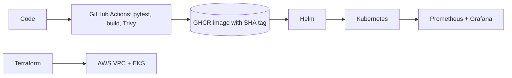

# PlaceTrack

DevOps final project by Raghavendra (24BCS10250)

For this project I built PlaceTrack, a small app to keep track of job and internship applications. You add a company and a role, and move it through applied, interview, offer or rejected. The app itself is simple on purpose. Most of my time went into the DevOps side: tests, Docker, a CI/CD pipeline with a security scan, Terraform on AWS, Kubernetes with Helm, and monitoring.

My presentation for the demo is here: [PlaceTrack-Capstone.pptx](PlaceTrack-Capstone.pptx)



| Part | Tools |
|---|---|
| Frontend | React, Vite, nginx |
| Backend | FastAPI, SQLAlchemy, Alembic |
| Database | PostgreSQL |
| CI/CD | GitHub Actions, GHCR, Trivy |
| Infrastructure | Terraform, AWS (VPC, EKS) |
| Deployment | Docker Compose, Kubernetes, Helm |
| Monitoring | Prometheus, Grafana |

```text
backend/            FastAPI app, migration, tests, Dockerfile
frontend/           React app, Dockerfile
docker-compose.yml  postgres, backend and frontend
helm/placetrack/    Helm chart
k8s/                namespace
terraform/          VPC and EKS
monitoring/         Prometheus and Grafana setup
troubleshooting/    two broken manifests and how I fixed them
scripts/            deploy and load test scripts
.github/workflows/  CI/CD pipeline
images/             screenshots
PlaceTrack-Capstone.pptx   my presentation
```

## M1: The app

The backend is FastAPI with Postgres. I wrote these endpoints: `GET/POST /api/jobs`, `GET/PUT/DELETE /api/jobs/{id}` and `GET /api/jobs/stats`. There are also `/health`, `/ready` and `/metrics` for Kubernetes and Prometheus. The `jobs` table is created by an Alembic migration (`backend/alembic/versions/`), and the API docs are at `/docs`.

The frontend is React. It shows the counts at the top, a filter for each status, and a table where I can edit or delete an application.


I also made sure it works on a small screen:


## M2: Tests

I wrote 16 pytest tests. They check every endpoint, bad input, missing ids (404), `/metrics`, and that `/ready` gives 503 when the database is down. The tests use an in-memory SQLite database, so they never touch the real Postgres. The settings are in `backend/pytest.ini`.

```bash
cd backend
python3.12 -m venv .venv && source .venv/bin/activate
pip install -r requirements-dev.txt
pytest -v
```


## M3: Git

I worked in small commits and wrote what each one changes in the message. `.gitignore` keeps `.env`, `__pycache__`, `node_modules`, `.venv` and the Terraform state out of the repo. I ran Gitleaks on the history and it found no secrets.


## M4: Docker

Both images run as a normal user, not root: the backend as user 10001 and the frontend as user 101. The frontend Dockerfile has two stages. Node builds the React app and only the built files go into the nginx image. With Docker Compose the whole app (postgres, backend, frontend) starts with one command:

```bash
docker compose up --build      # open http://localhost:3000
```


## M5: CI/CD

My workflow is `.github/workflows/ci-cd.yml` and it runs on every push to `main`. First it runs pytest and builds the frontend. If both pass, it builds the two Docker images, scans them with Trivy and pushes them to GHCR as `ghcr.io/raghavendra1729-cell/placetrack-<service>:<commit SHA>`. I tag every image with the commit SHA and not `latest`, so I always know which code is running. If a test fails or Trivy finds a fixable HIGH or CRITICAL problem, the pipeline stops and nothing is pushed.

I also added a `deploy` job. It runs on a self-hosted runner on my laptop and does a Helm upgrade on minikube with the new SHA, so a push updates the running app by itself. I turn it on with the repository variable `DEPLOY_ENABLED` only when my laptop is ready, otherwise the job is skipped.

This run passed all five jobs, including the deploy: [Actions run](https://github.com/Raghavendra1729-cell/placetrack-devops-capstone/actions/runs/38878841957).


Both images are public in GHCR with the commit SHA as the tag:


## M6: Trivy

Trivy scans both images in the pipeline and fails the job on fixable HIGH or CRITICAL findings.

My first scan actually failed. The backend had 3 HIGH findings in Starlette 0.41.3, for example CVE-2025-62727, where crafted `Range` headers can be used for a denial of service. The old Alpine nginx image in the frontend had 42 HIGH and CRITICAL findings in OpenSSL, libexpat and libxml2. I upgraded FastAPI, which pulled in a newer Starlette without these problems, and moved the frontend to `nginx-unprivileged:1.30.5-alpine`. After that both images scanned clean. A clean scan does not mean the image is safe forever, only that nothing fixable was known on that day, which is why it runs on every build.

The Trivy step from the run above:


## M7: Terraform

In `terraform/` I describe the AWS setup: a VPC with two public subnets in two availability zones, and an EKS 1.35 cluster with a node group of two `t3.small` nodes, in ap-south-1. Only my IP can reach the cluster API (`api_access_cidrs`). I keep that value in `terraform.tfvars`, which is not committed, and there are no AWS keys in the repo.

```bash
cd terraform
terraform init
terraform validate
terraform plan -out=tfplan
terraform apply tfplan
terraform destroy
```

The plan wants to create 49 resources:


After `terraform apply` I checked everything in the AWS Console: the VPC with its two subnets, the cluster, and the two nodes in Ready state.


EKS costs money every hour, so after the screenshots I ran `terraform destroy`. It removed all 49 resources, and I checked that no cluster or VPC was left:


## M8: Kubernetes and Helm

I packed the app into a Helm chart (`helm/placetrack`). It creates the backend and the frontend with 2 replicas each, ClusterIP services, Postgres, a Job that runs the migration, an HPA for the backend, and an Ingress for `placetrack.local` that sends `/` to the frontend and `/api` to the backend. To keep the AWS bill low I ran the chart on minikube on my laptop, using the images the pipeline pushed to GHCR.

```bash
minikube start -p placetrack --driver=docker --cpus=4 --memory=5500
minikube -p placetrack addons enable ingress
minikube -p placetrack addons enable metrics-server
kubectl apply -f k8s/namespace.yaml
helm upgrade --install placetrack helm/placetrack -n placetrack --set image.tag=<commit SHA> --wait
kubectl -n ingress-nginx port-forward svc/ingress-nginx-controller 8080:80      # open http://placetrack.local:8080
```

For the host name I added `127.0.0.1 placetrack.local` to `/etc/hosts`.


When I ran the load test, CPU went above the 60% target and the HPA added a third backend pod:


## M9: Monitoring

The backend exposes `/metrics`. `monitoring/install.sh` installs Prometheus and Grafana, and the ServiceMonitor in my chart tells Prometheus to scrape the backend pods. I made a small Grafana dashboard with requests per second, p95 latency, errors and the number of backend pods.

```bash
./monitoring/install.sh
helm upgrade placetrack helm/placetrack -n placetrack --reuse-values --set serviceMonitor.enabled=true
./scripts/load-test.sh http://localhost:8080 60
```


The dashboard shows 3 pods because the HPA had just scaled up:


## Troubleshooting

I broke two things on purpose to practise finding problems: a wrong image tag (`ImagePullBackOff`) and a Service with a wrong selector (no endpoints). How I found and fixed each one is in [troubleshooting/](troubleshooting/README.md).


## Live demo

1. Open the app at `http://placetrack.local:8080`.
2. Change the subtitle in `frontend/src/App.jsx`, then `git commit` and `git push`.
3. Watch the pipeline in GitHub Actions: test, frontend, image and then deploy.
4. The deploy job runs `scripts/deploy.sh` with the commit SHA on my laptop. Watch the pods change with `kubectl -n placetrack get pods -w`.
5. Refresh the browser and the new subtitle is there.

## What I learned

* A build that passes can still be insecure. Trivy failed my first images even though everything worked.
* nginx looks up the backend name only once when it starts, and its resolver does not use the Kubernetes search domains. I got a 502 until I used the full name `<service>.<namespace>.svc.cluster.local`.
* A pod can be Running but not Ready. My backend pods stayed at 0/1 until they could reach Postgres, because `/ready` checks the database.
* The database password Secret has to survive `helm uninstall`, because the Postgres volume still has the old password.
* Passwords are generated at deploy time and never committed.
