# PlaceTrack: DevOps Capstone

Raghavendra, 24BCS10250

PlaceTrack is a small web app to track job and internship applications. You add a company and a role and move it through applied, interview, offer or rejected. The app is simple. The project is about the pipeline around it: tests, Docker, CI with a security scan, Terraform, Kubernetes with Helm, and monitoring.

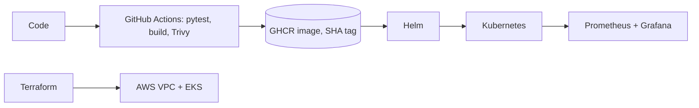

| Part | Tools |
|---|---|
| Frontend | React, Vite, nginx |
| Backend | FastAPI, SQLAlchemy, Alembic |
| Database | PostgreSQL |
| CI/CD | GitHub Actions, GHCR, Trivy |
| Infrastructure | Terraform, AWS (VPC, EKS) |
| Deploy | Docker Compose, Kubernetes, Helm |
| Monitoring | Prometheus, Grafana |

```text
backend/            FastAPI app, migration, tests, Dockerfile
frontend/           React app, Dockerfile
docker-compose.yml  postgres + backend + frontend
helm/placetrack/    Helm chart
k8s/                namespace
terraform/          VPC and EKS
monitoring/         Prometheus/Grafana values and dashboard
troubleshooting/    two broken manifests and the fixes
scripts/            deploy and load test helpers
.github/workflows/  CI/CD pipeline
docs/               presentation
images/             screenshots
```

## M1 Application

The backend has `GET/POST /api/jobs`, `GET/PUT/DELETE /api/jobs/{id}`, `GET /api/jobs/stats`, and `/health`, `/ready` and `/metrics`. The `jobs` table is created by the Alembic migration in `backend/alembic/versions/`. Swagger is at `/docs`.


## M2 Tests

16 pytest tests cover every endpoint, validation errors, 404s, `/metrics` and `/ready` returning 503 when the database is down. They use an in-memory SQLite database instead of Postgres. Config is in `backend/pytest.ini`.

```bash
cd backend
python3.12 -m venv .venv && source .venv/bin/activate
pip install -r requirements-dev.txt
pytest -v
```


## M3 Git

Small commits with clear messages. `.gitignore` covers `.env`, `__pycache__`, `node_modules`, `.venv` and Terraform state. Gitleaks finds no secrets in the history.


## M4 Docker

The backend image runs as user 10001. The frontend Dockerfile is multi-stage (Node builds, nginx serves) and runs as user 101. Compose starts postgres, the backend and the frontend.

```bash
docker compose up --build        # http://localhost:3000
```


## M5 CI/CD

`.github/workflows/ci-cd.yml` runs on every push to `main`. It runs pytest, builds the frontend, builds both Docker images, scans them with Trivy and pushes them to GHCR as `ghcr.io/raghavendra1729-cell/placetrack-<service>:<commit SHA>`. A failing test or a HIGH/CRITICAL finding stops the pipeline. The images are tagged with the commit SHA, not `latest`.

Status: the repository is not pushed yet, so the Actions run link and the GHCR screenshot are still to add. I ran the same steps locally (pytest, `npm run build`, `docker build`, Trivy).

## M6 Trivy

Trivy scans the backend and frontend images in the pipeline and fails on fixable HIGH or CRITICAL findings.

My first scan failed. The backend had 3 HIGH findings in Starlette 0.41.3 (for example CVE-2025-62727, a denial of service through crafted `Range` headers). The old Alpine nginx image used by the frontend had 42 HIGH and CRITICAL findings in OpenSSL, libexpat and libxml2. I upgraded FastAPI (Starlette 1.7.0) and moved to `nginx-unprivileged:1.30.5-alpine`. Both images now scan clean. A clean scan means no fixable HIGH or CRITICAL vulnerability is in the image at scan time, so it runs on every build.

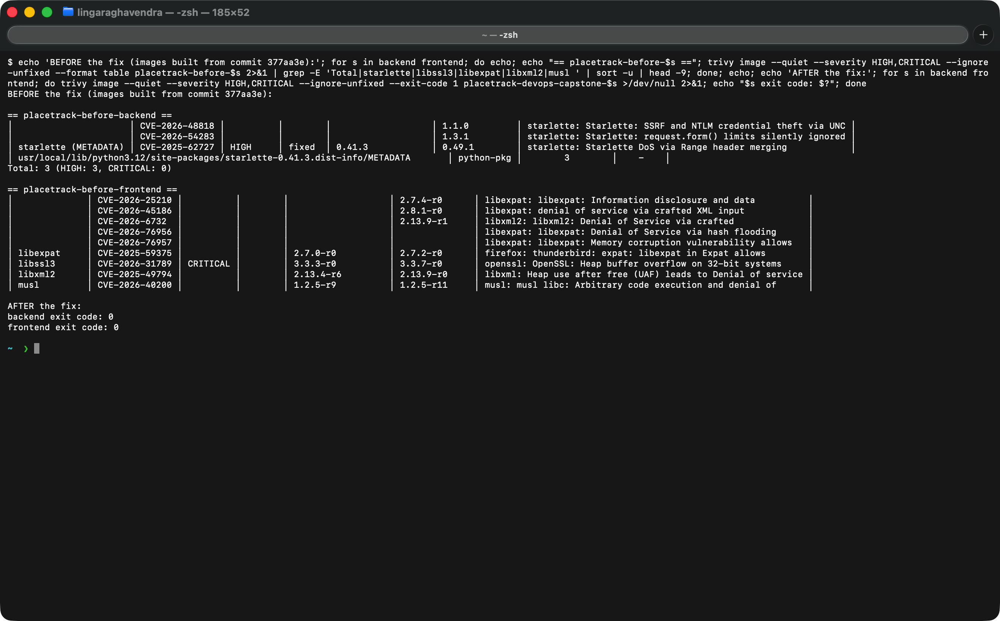

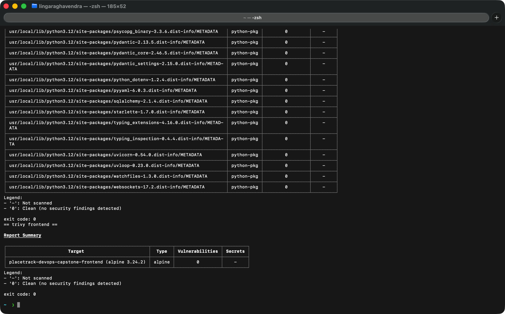

## M7 Terraform

`terraform/` creates a VPC with two public subnets in two availability zones, and an EKS cluster with a managed node group of `t3.small` nodes (this AWS account's free plan does not allow `t3.medium`). The API endpoint is limited to my IP through `api_access_cidrs` in the git-ignored `terraform.tfvars`. No credentials are in the repo.

```bash
cd terraform
terraform init
terraform validate
terraform plan -out=tfplan
terraform apply tfplan
terraform destroy
```

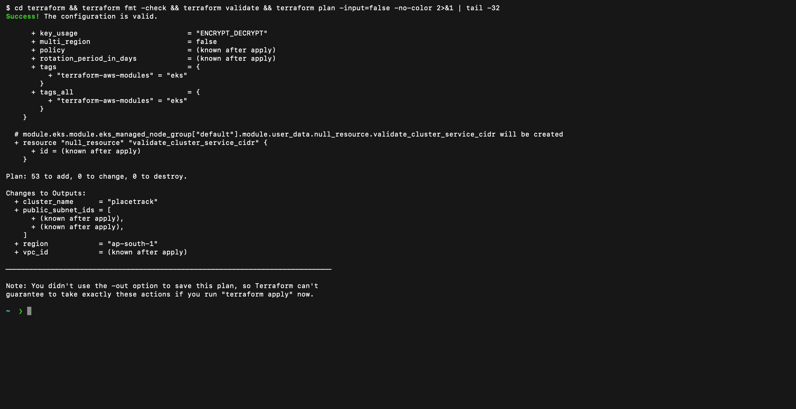

The first apply created the VPC and the cluster, but the node group failed: this account's free plan rejected `t3.medium` ("not eligible for Free Tier"). I changed the node type to `t3.small` and applied again. The result:

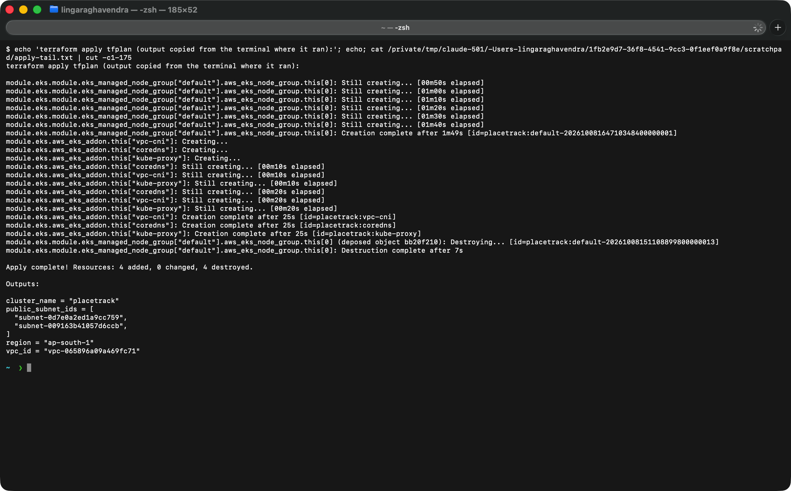

Both nodes are Ready and the system pods (CNI, CoreDNS, kube-proxy) are running:

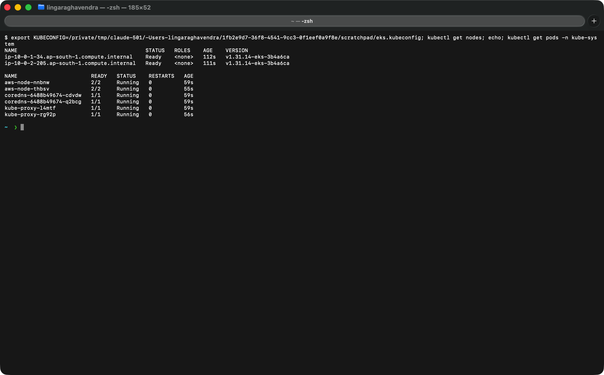

The AWS Console shows the VPC with its two public subnets, and the EKS cluster:

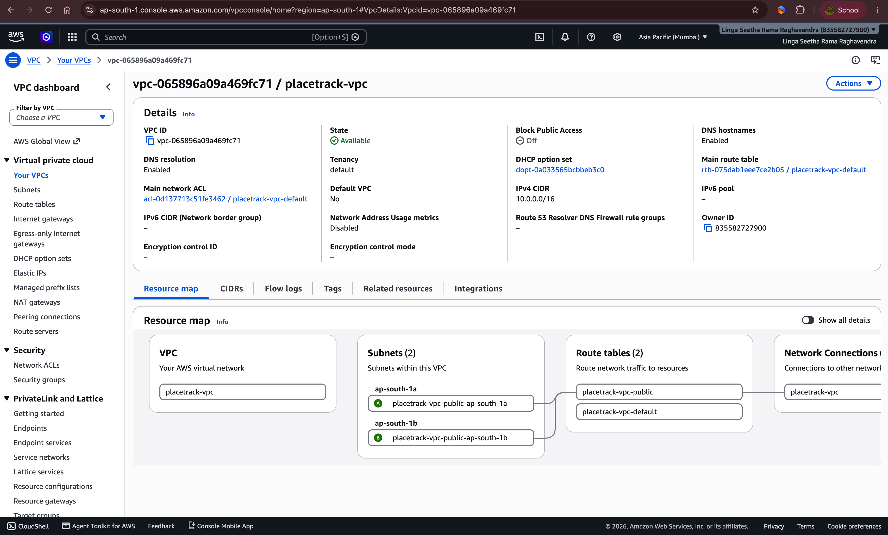

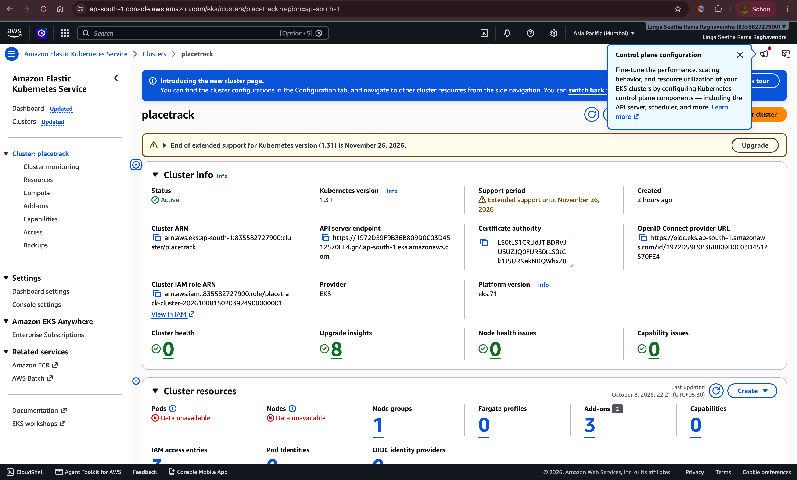

Status: the `terraform destroy` output is still to add.

## M8 Kubernetes and Helm

The Helm chart deploys the backend and frontend (2 replicas each), ClusterIP services, an Ingress (`/` to the frontend, `/api` to the backend), Postgres, a migration Job and an HPA into the `placetrack` namespace.

```bash
minikube start -p placetrack --driver=docker --cpus=4 --memory=5500
minikube -p placetrack addons enable ingress
minikube -p placetrack addons enable metrics-server
docker build -t ghcr.io/raghavendra1729-cell/placetrack-backend:local backend
docker build -t ghcr.io/raghavendra1729-cell/placetrack-frontend:local frontend
minikube -p placetrack image load ghcr.io/raghavendra1729-cell/placetrack-backend:local ghcr.io/raghavendra1729-cell/placetrack-frontend:local
kubectl apply -f k8s/namespace.yaml
helm upgrade --install placetrack helm/placetrack -n placetrack --set ingress.host= --wait
kubectl -n ingress-nginx port-forward svc/ingress-nginx-controller 8080:80      # http://localhost:8080
```

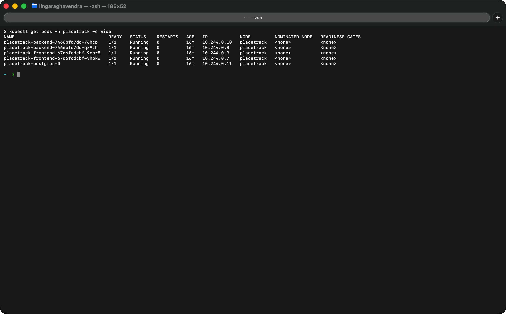

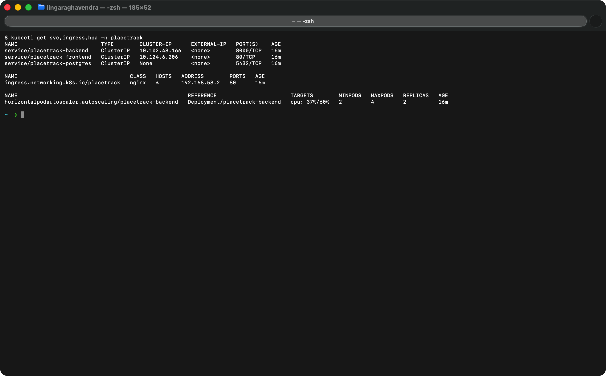

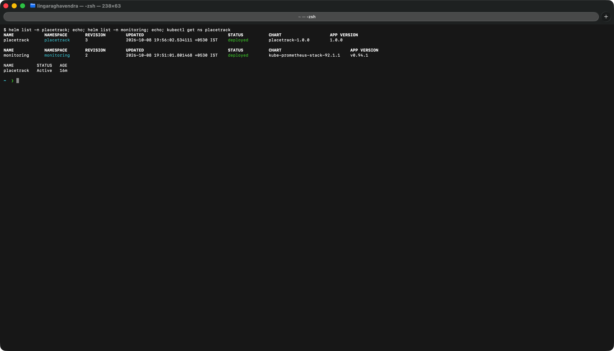

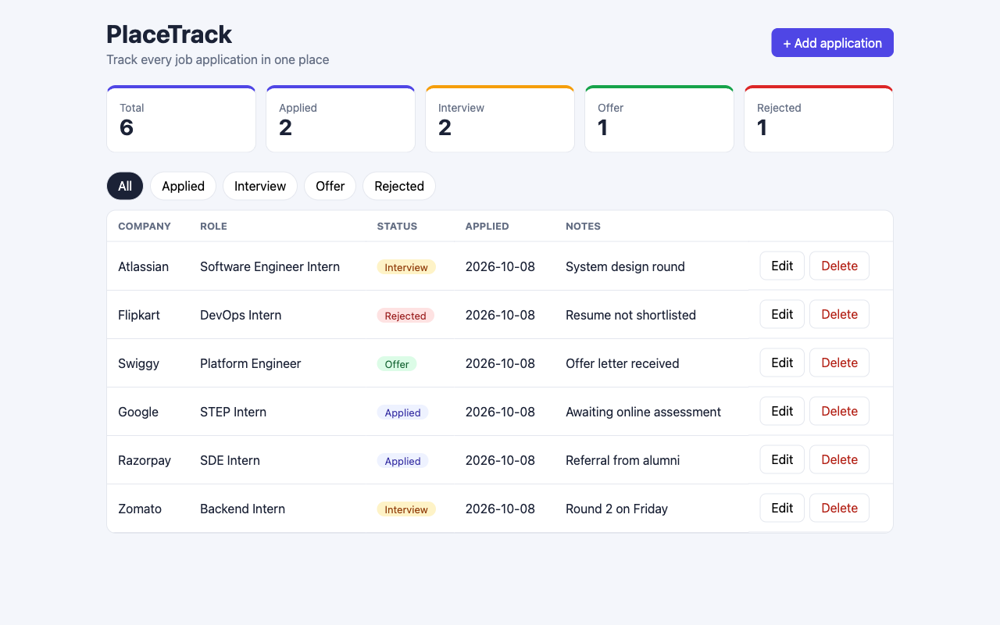

## M9 Monitoring

The backend exposes `/metrics`. `monitoring/install.sh` installs Prometheus and Grafana, and the chart's ServiceMonitor makes Prometheus scrape the backend.

```bash
./monitoring/install.sh
helm upgrade placetrack helm/placetrack -n placetrack --reuse-values --set serviceMonitor.enabled=true
./scripts/load-test.sh http://localhost:8080 60
```

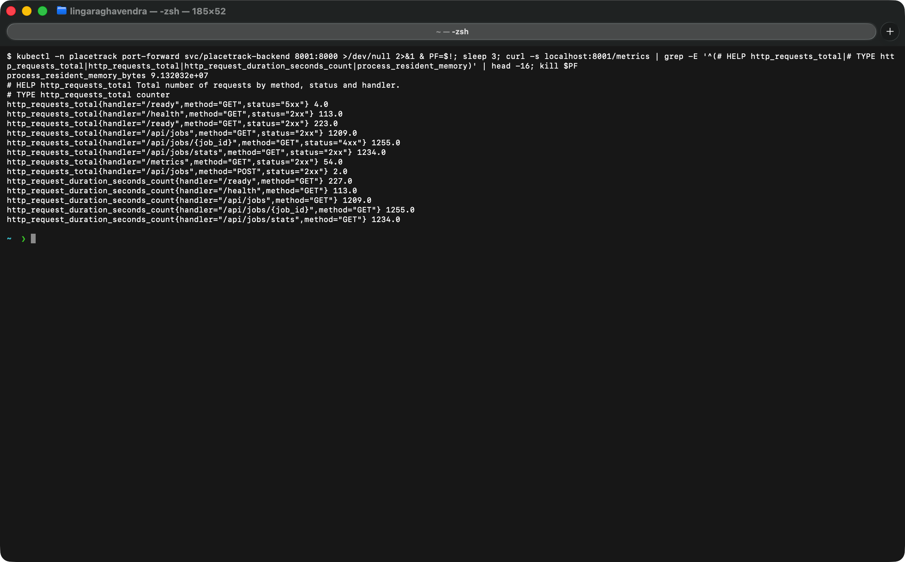

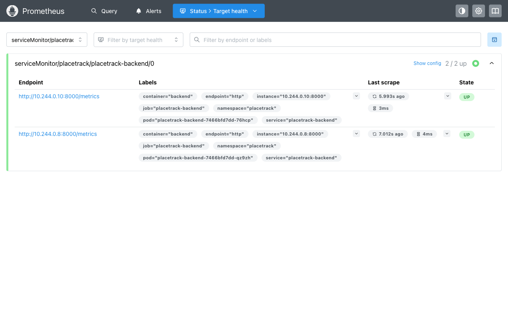

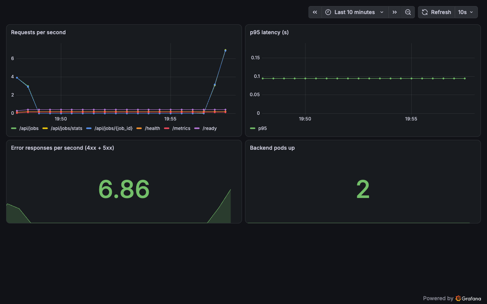

## Troubleshooting

I broke two things on purpose and fixed them: a bad image tag (`ImagePullBackOff`) and a Service selector typo (no endpoints). The steps and output are in [`troubleshooting/`](troubleshooting/README.md).

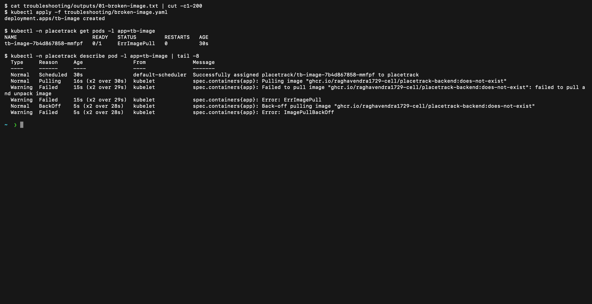

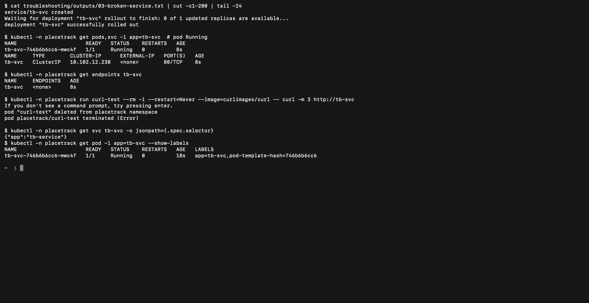

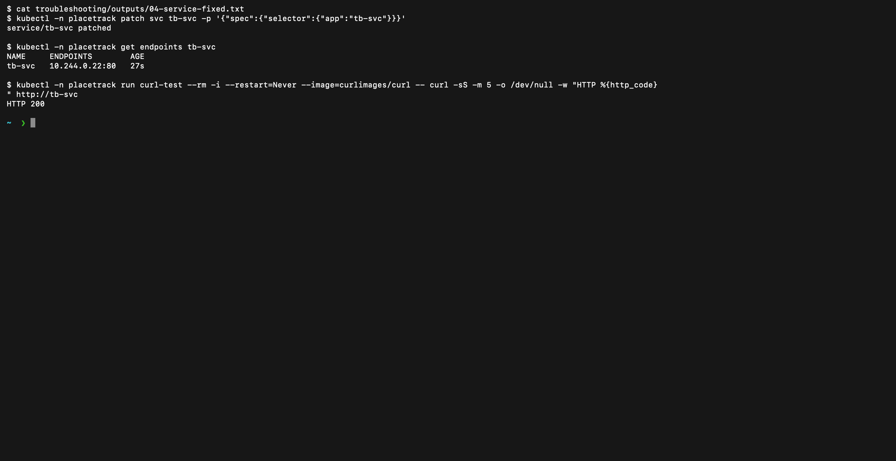

## Live demo

1. Show the running app at `http://localhost:8080`.
2. Change the subtitle in `frontend/src/App.jsx`, then `git commit` and `git push`.
3. Show the pipeline run in GitHub Actions.
4. Deploy the new image: `scripts/deploy.sh <commit SHA>`.
5. Refresh the browser to see the change.

## What I learned

* A passing build is not a secure build. Trivy failed my first images.
* nginx resolves a `proxy_pass` name once at startup, and its resolver ignores DNS search domains. The full name `<service>.<namespace>.svc.cluster.local` fixed the 502 through the frontend.
* A running pod is not a ready pod, and a ready pod is not always reachable.
* A generated Secret must outlive the Helm release, because the database volume keeps the old password.
* Secrets are generated at deploy time and never committed.
