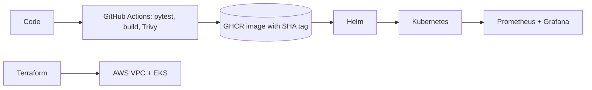

# PlaceTrack

DevOps final project by Raghavendra (24BCS10250)

PlaceTrack is a small web app to keep track of job and internship applications. You add a company and a role, and move it through applied, interview, offer or rejected. The app is simple. The main work in this project is the DevOps part around it: tests, Docker, a CI pipeline with a security scan, Terraform, Kubernetes with Helm, and monitoring.



| Part | Tools |
|---|---|
| Frontend | React, Vite, nginx |
| Backend | FastAPI, SQLAlchemy, Alembic |
| Database | PostgreSQL |
| CI/CD | GitHub Actions, GHCR, Trivy |
| Infrastructure | Terraform, AWS (VPC, EKS) |
| Deployment | Docker Compose, Kubernetes, Helm |
| Monitoring | Prometheus, Grafana |

```text
backend/            FastAPI app, migration, tests, Dockerfile
frontend/           React app, Dockerfile
docker-compose.yml  postgres, backend and frontend
helm/placetrack/    Helm chart
k8s/                namespace
terraform/          VPC and EKS
monitoring/         Prometheus and Grafana setup
troubleshooting/    two broken manifests and how I fixed them
scripts/            deploy and load test scripts
.github/workflows/  CI/CD pipeline
images/             screenshots
PlaceTrack-Capstone.pptx   presentation
```

## M1 Application

The backend has these endpoints: `GET/POST /api/jobs`, `GET/PUT/DELETE /api/jobs/{id}`, `GET /api/jobs/stats`, `/health`, `/ready` and `/metrics`. The `jobs` table is created by the Alembic migration in `backend/alembic/versions/`. The API docs are at `/docs`.


## M2 Tests

There are 16 pytest tests. They cover all the endpoints, validation errors, 404s, `/metrics`, and `/ready` returning 503 when the database is down. The tests use an in-memory SQLite database instead of Postgres. The config is in `backend/pytest.ini`.

```bash
cd backend
python3.12 -m venv .venv && source .venv/bin/activate
pip install -r requirements-dev.txt
pytest -v
```


## M3 Git

I made small commits with clear messages. `.gitignore` covers `.env`, `__pycache__`, `node_modules`, `.venv` and Terraform state. Gitleaks found no secrets in the history.


## M4 Docker

The backend image runs as user 10001. The frontend Dockerfile is multi-stage (Node builds the app, nginx serves it) and runs as user 101. Docker Compose starts postgres, the backend and the frontend.

```bash
docker compose up --build      # open http://localhost:3000
```


## M5 CI/CD

The workflow `.github/workflows/ci-cd.yml` runs on every push to `main`. It runs pytest, builds the frontend, builds both Docker images, scans them with Trivy and pushes them to GHCR as `ghcr.io/raghavendra1729-cell/placetrack-<service>:<commit SHA>`. If a test fails or Trivy finds a fixable HIGH or CRITICAL problem, the pipeline stops and nothing is pushed. The images are tagged with the commit SHA and not `latest`.

After the images are pushed, the `deploy` job runs on a self-hosted runner on my laptop and deploys the new SHA to minikube with Helm. It only runs on `main` when the repository variable `DEPLOY_ENABLED` is `true`, so the pipeline still passes when the runner is off.

This run passed all five jobs, including the deploy: [Actions run](https://github.com/Raghavendra1729-cell/placetrack-devops-capstone/actions/runs/38878841957).


Both images are public in GHCR, tagged with the commit SHA:


## M6 Trivy

Trivy scans the backend and frontend images in the pipeline and fails the job on fixable HIGH or CRITICAL findings.

My first scan failed. The backend had 3 HIGH findings in Starlette 0.41.3 (for example CVE-2025-62727, a denial of service with crafted `Range` headers). The old Alpine nginx image in the frontend had 42 HIGH and CRITICAL findings in OpenSSL, libexpat and libxml2. I upgraded FastAPI, which brings a newer Starlette without these CVEs, and moved to `nginx-unprivileged:1.30.5-alpine`. After that both images scan clean. A clean result only means there is no fixable HIGH or CRITICAL vulnerability at the time of the scan. New CVEs come out all the time, so the scan runs on every build.

The Trivy step from the run above, for both images:


## M7 Terraform

`terraform/` creates a VPC with two public subnets in two availability zones and an EKS 1.35 cluster with a managed node group of two `t3.small` nodes. The API endpoint is limited to my IP with the `api_access_cidrs` variable, which I set in a `terraform.tfvars` file that is not committed. No credentials are stored in the repo.

```bash
cd terraform
terraform init
terraform validate
terraform plan -out=tfplan
terraform apply tfplan
terraform destroy
```

The plan adds 49 resources:


After `terraform apply`, the AWS Console in ap-south-1 shows the VPC with its two public subnets, the EKS cluster and its two nodes:


After the screenshots I ran `terraform destroy`, which removed all 49 resources:


## M8 Kubernetes and Helm

The Helm chart in `helm/placetrack` creates the backend and frontend (2 replicas each), ClusterIP services and an Ingress for the host `placetrack.local` (`/` goes to the frontend and `/api` to the backend). It also creates Postgres, a Job for the migration and an HPA, all in the `placetrack` namespace, and it runs the images from GHCR. I ran the chart on a local minikube cluster and not on EKS, to keep the AWS cost low.

```bash
minikube start -p placetrack --driver=docker --cpus=4 --memory=5500
minikube -p placetrack addons enable ingress
minikube -p placetrack addons enable metrics-server
kubectl apply -f k8s/namespace.yaml
helm upgrade --install placetrack helm/placetrack -n placetrack --set image.tag=<commit SHA> --wait
kubectl -n ingress-nginx port-forward svc/ingress-nginx-controller 8080:80      # open http://placetrack.local:8080
```

The host name needs this line in `/etc/hosts`: `127.0.0.1 placetrack.local`.


During the load test the HPA scaled the backend from 2 to 3 pods because CPU went above the 60% target:


## M9 Monitoring

The backend exposes `/metrics`. `monitoring/install.sh` installs Prometheus and Grafana, and the ServiceMonitor in the chart makes Prometheus scrape the backend.

```bash
./monitoring/install.sh
helm upgrade placetrack helm/placetrack -n placetrack --reuse-values --set serviceMonitor.enabled=true
./scripts/load-test.sh http://localhost:8080 60
```


The Grafana panel "Backend pods up" shows 3 because the HPA had added a third pod:


## Troubleshooting

I broke two things on purpose and fixed them: a wrong image tag (`ImagePullBackOff`) and a Service selector typo (no endpoints). The steps and the output are in [troubleshooting/](troubleshooting/README.md).


## Live demo

Before the demo, minikube and the runner are started and the repository variable `DEPLOY_ENABLED` is `true`.

1. Show the running app at `http://placetrack.local:8080`.
2. Change the subtitle in `frontend/src/App.jsx`, then `git commit` and `git push`.
3. Show the pipeline run in GitHub Actions: test, frontend, image and then deploy.
4. The deploy job runs `scripts/deploy.sh` with the commit SHA on my laptop. Show the pods being replaced with `kubectl -n placetrack get pods -w`.
5. Refresh the browser to see the change.

## What I learned

* A build that passes can still have security problems. Trivy failed my first images.
* nginx looks up the backend name only once at startup, and its resolver does not use the DNS search domains. Using the full name `<service>.<namespace>.svc.cluster.local` fixed the 502 error.
* A pod can be Running but not Ready. My backend pods stayed 0/1 until they could reach Postgres, because `/ready` checks the database.
* The database password Secret has to stay after `helm uninstall`, because the volume keeps the old password.
* Passwords and keys are generated when deploying and are never committed.
