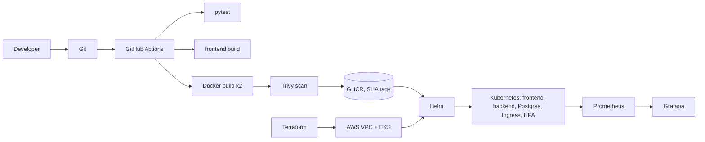

# PlaceTrack — DevOps Capstone

PlaceTrack is a small web app for tracking job and internship applications: add a company and role, move it through **applied → interview → offer / rejected**, and see counts at a glance. The app is deliberately simple; the point of the project is the path it takes from a laptop to a monitored Kubernetes cluster:



| Layer | Technology |
|---|---|
| Frontend | React 18 + Vite, served by unprivileged nginx |
| Backend | FastAPI, SQLAlchemy 2, Alembic migrations |
| Database | PostgreSQL 16 |
| Tests | pytest (SQLite test database) |
| Containers | Docker, Docker Compose |
| CI/CD | GitHub Actions, GHCR, Trivy |
| Infrastructure | Terraform (VPC + EKS on AWS `ap-south-1`) |
| Orchestration | Kubernetes, Helm, nginx Ingress, HPA |
| Observability | Prometheus, Grafana (kube-prometheus-stack), ServiceMonitor |

## Repository layout

```text
backend/            FastAPI app, Alembic migrations, tests, Dockerfile
frontend/           React app, nginx template, multi-stage Dockerfile
docker-compose.yml  Full local stack (postgres, backend, frontend)
k8s/                Namespace manifest
helm/placetrack/    Helm chart (deployments, services, ingress, HPA, Postgres, migration job, ServiceMonitor)
terraform/          VPC with 2 public subnets + EKS node group
monitoring/         kube-prometheus-stack values, Grafana dashboard, install script
troubleshooting/    Two deliberately broken manifests and the fix notes
scripts/            deploy.sh, load-test.sh, term-shot.sh (screenshot helper)
.github/workflows/  CI/CD pipeline
docs/               Design spec, implementation plan, presentation material
images/             Real screenshots used in this README
```

## M1 — Application

Endpoints (Swagger UI at `/docs`):

| Method | Path | Purpose |
|---|---|---|
| GET | `/api/jobs` (`?status=`) | List applications |
| POST | `/api/jobs` | Create |
| GET / PUT / DELETE | `/api/jobs/{id}` | Read / replace / delete |
| GET | `/api/jobs/stats` | Counts per status |
| GET | `/health`, `/ready`, `/metrics` | Liveness, readiness (checks the database), Prometheus metrics |

The single table `jobs` is created by the Alembic migration `backend/alembic/versions/0001_create_jobs.py`.

The dashboard running through `docker compose` on `http://localhost:3000`, and at phone width:


## M2 — Tests

16 pytest cases cover all CRUD endpoints, `/health`, `/ready` (including a 503 when the database is down), `/metrics`, validation (invalid status, blank company) and 404 handling. They run against an in-memory SQLite database injected through FastAPI's dependency override, so production Postgres is never touched. Config lives in `backend/pytest.ini`.

```bash
cd backend && python3.12 -m venv .venv && source .venv/bin/activate
pip install -r requirements-dev.txt && pytest -v
```


## M3 — Git

Small commits with descriptive messages (`git log --oneline`); `.gitignore` excludes `.env`, `__pycache__`, `node_modules`, `.venv`, Terraform state and `*.tfvars`. Gitleaks reports no leaks in the history.


## M4 — Docker

* `backend/Dockerfile` — `python:3.12-slim`, runs as UID 10001.
* `frontend/Dockerfile` — multi-stage: `node:20-alpine` builds the bundle, `nginx-unprivileged` serves it as UID 101. nginx resolves the backend name at request time, so the container still starts if the backend is not up yet (found and fixed during Kubernetes testing, see lessons).
* `docker-compose.yml` — postgres (with healthcheck), backend (runs `alembic upgrade head` first), frontend on port 3000.

```bash
docker compose up --build
# http://localhost:3000   http://localhost:8000/docs
```


## M5 — CI/CD

`.github/workflows/ci-cd.yml` runs on every push to `main` (and on pull requests):

1. **test** — installs the backend and runs `pytest -v` (a failure stops the pipeline).
2. **frontend** — `npm ci && npm run build`.
3. **image** (matrix: backend, frontend) — builds the image, scans it with Trivy, then logs in to GHCR and pushes `ghcr.io/raghavendra1729-cell/placetrack-<service>:<commit SHA>`. Images are tagged with the commit SHA, never `latest`.

Third-party actions are pinned to commit SHAs, and the workflow token is read-only except for the `image` job, which needs `packages: write`.

> **Status:** this repository has not been pushed to GitHub yet, so there is no Actions run URL or GHCR page to show. The pipeline's test, build and scan steps were run locally instead: `pytest` (above), `npm run build`, `docker build` and Trivy (Gitleaks was run as an extra check). The GHCR login and push steps need GitHub and have not run. The workflow file is committed and validated as YAML. Once pushed, add the run link and a GHCR screenshot here.

## M6 — DevSecOps (Trivy)

The pipeline fails on fixable HIGH or CRITICAL vulnerabilities (`severity: HIGH,CRITICAL`, `ignore-unfixed: true`, `exit-code: 1`) in **both** images.

My first scan failed the gate. The backend image had **3 HIGH** findings in Starlette 0.41.3 (pulled in by the FastAPI version I had pinned), for example **CVE-2025-62727**, a denial of service through crafted `Range` headers. The frontend image, built on an older Alpine nginx, had **40 HIGH and 2 CRITICAL** findings in system libraries such as OpenSSL (`libssl3`, CVE-2026-31789, a heap buffer overflow on 32-bit systems) and libexpat/libxml2.

Fixing them properly instead of ignoring them: upgraded FastAPI (which brings Starlette 1.7.0) and the rest of the Python pins, and moved the frontend to `nginx-unprivileged:1.30.5-alpine` on Alpine 3.24. Both images now scan clean (exit code 0).

Before the fix, then after:


**What this means:** Trivy inspects the OS packages and Python/npm libraries inside the finished image. A clean result means that no fixable HIGH/CRITICAL vulnerability is present at scan time; it does not mean the image can never become vulnerable, which is why the scan runs on every build.

## M7 — Terraform (AWS)

`terraform/` uses the community VPC and EKS modules:

* VPC `10.0.0.0/16` with **two public subnets** in two availability zones (no NAT gateway, to keep the cost low).
* EKS cluster with a managed node group of two `t3.medium` nodes and the EBS CSI driver (own IRSA role, so only that service account gets the volume permissions).
* The public API endpoint is limited to my own IP through a required variable (`api_access_cidrs`); the value lives in the git-ignored `terraform.tfvars`, and `terraform.tfvars.example` documents the format. No credentials are in the repository; Terraform uses the AWS CLI profile.

```bash
cd terraform
terraform init && terraform fmt -check && terraform validate
terraform plan -out=tfplan      # Plan: 53 to add, 0 to change, 0 to destroy
```


> **Status:** `init`, `validate` and `plan` are done and shown above. `terraform apply` creates billable AWS resources and was not run yet, so there are no console screenshots (VPC, EKS) or `terraform destroy` output. After applying, add them here (`images/09-tf-apply.png`, `11-aws-vpc.png`, `12-aws-eks.png`, `10-tf-destroy.png`) and always run `terraform destroy` afterwards.

## M8 — Kubernetes and Helm

`k8s/namespace.yaml` creates the `placetrack` namespace. The chart in `helm/placetrack` deploys:

* backend and frontend Deployments, **2 replicas each**, non-root, with readiness/liveness probes;
* **ClusterIP** Services for backend (8000) and frontend (80);
* an **Ingress** routing `/` to the frontend and `/api` to the backend;
* a Postgres StatefulSet with a persistent volume, a generated database Secret, and a post-install **Alembic migration Job**;
* an HPA for the backend (2–4 pods at 60% CPU).

### Deploy on minikube

```bash
minikube start -p placetrack --driver=docker --cpus=4 --memory=5500
minikube -p placetrack addons enable ingress
minikube -p placetrack addons enable metrics-server
docker build -t ghcr.io/raghavendra1729-cell/placetrack-backend:local backend
docker build -t ghcr.io/raghavendra1729-cell/placetrack-frontend:local frontend
minikube -p placetrack image load ghcr.io/raghavendra1729-cell/placetrack-backend:local ghcr.io/raghavendra1729-cell/placetrack-frontend:local
kubectl apply -f k8s/namespace.yaml
helm upgrade --install placetrack helm/placetrack -n placetrack --set ingress.host= --wait --timeout 300s
kubectl -n ingress-nginx port-forward svc/ingress-nginx-controller 8080:80   # then open http://localhost:8080
```

`--set ingress.host=` makes the Ingress match any host so `localhost` works; set a host such as `placetrack.local` if you map it in `/etc/hosts`. The generated database Secret and the Postgres volume are both kept on `helm uninstall`; to start from scratch also run `kubectl -n placetrack delete secret placetrack-db pvc data-placetrack-postgres-0`.

### Deploy on EKS (after `terraform apply`)

The images must have been pushed by CI, and the two GHCR packages set to Public so the cluster can pull them.

```bash
aws eks update-kubeconfig --region ap-south-1 --name placetrack
kubectl apply -f k8s/storageclass-ebs-gp3.yaml      # gives the Postgres volume a default class
helm upgrade --install ingress-nginx ingress-nginx --repo https://kubernetes.github.io/ingress-nginx -n ingress-nginx --create-namespace --wait
helm upgrade --install metrics-server metrics-server --repo https://kubernetes-sigs.github.io/metrics-server/ -n kube-system --wait
scripts/deploy.sh <commit-sha> --set image.pullPolicy=Always --set postgres.storageClass=ebs-gp3
kubectl -n ingress-nginx get svc ingress-nginx-controller   # EXTERNAL-IP is the app URL
```

Run `helm uninstall ingress-nginx -n ingress-nginx` before `terraform destroy` so the load balancer is removed.

Tested on minikube (output below):


The application through the Ingress controller (the Ingress matches any host locally, so it works on `localhost`):


## M9 — Observability

The backend exposes Prometheus metrics at `/metrics` (request counts, latency histograms). `monitoring/install.sh` installs kube-prometheus-stack (Prometheus and Grafana) and the PlaceTrack dashboard; the chart's `ServiceMonitor` (enabled with `--set serviceMonitor.enabled=true`) makes Prometheus scrape both backend pods. The Grafana admin password is generated into a Kubernetes Secret at install time.

```bash
./monitoring/install.sh
helm upgrade placetrack helm/placetrack -n placetrack --reuse-values --set serviceMonitor.enabled=true
./scripts/load-test.sh http://localhost:8080 60   # generate traffic
```

`/metrics` taken directly from the backend Service:


Prometheus Targets page — both backend pods **UP**:


Grafana dashboard with live request rate, p95 latency, error responses and backend pod count:


## Troubleshooting

Two faults were introduced and fixed on the live cluster; full write-ups with the five steps (identify, investigate, root cause, fix, verify) are in [`troubleshooting/README.md`](troubleshooting/README.md).

1. **Bad image tag** → `ErrImagePull` / `ImagePullBackOff`; fixed by pointing the Deployment at an existing tag.
2. **Service selector mismatch** → pod `Running` but endpoints `<none>`; fixed by correcting the selector.


## Lessons learned

* **A passing build is not a secure build.** Trivy found 3 HIGH CVEs in the backend and 42 HIGH/CRITICAL in the frontend base image on the very first scan; keeping dependencies and base images current was the fix.
* **nginx resolves `proxy_pass` hostnames once at startup, and its `resolver` ignores DNS search domains.** The frontend pods crashed at install time because the backend Service name was not resolvable yet; a runtime resolver removed the crash loop, but the short name `placetrack-backend` still did not resolve, so `/api` through the frontend Service returned 502. An independent review caught it; using the fully qualified name `<svc>.<namespace>.svc.cluster.local` fixed it (502 became 200).
* **`Running` is not `Ready`, and `Ready` is not reachable.** A Service selector typo left a healthy pod with no endpoints.
* **Prometheus needs a config reload.** The new ServiceMonitor was only scraped after Prometheus reloaded its configuration.
* **A generated Secret must outlive the release that created it.** After `helm uninstall` the Postgres volume kept the old password, so a reinstall generated a new one and the backend could no longer log in. Annotating the Secret with `helm.sh/resource-policy: keep` fixed it.
* **Never commit secrets.** The database password is generated by Helm, the Grafana password by the install script, and Terraform values live in a git-ignored file.
* **Automated security review catches real mistakes.** It flagged workflow permissions, unpinned actions, an open EKS API endpoint and a hardcoded password, all fixed.

## Rubric evidence map

| Module | Where to look | Status |
|---|---|---|
| M1 Application | `backend/app/`, `backend/alembic/versions/`, `frontend/`, `docker-compose.yml`, `images/01-app-compose.png`, `images/01b-app-mobile.png` | Done |
| M2 Testing | `backend/tests/`, `backend/pytest.ini`, `images/02-pytest.png` | Done (16 passing) |
| M3 Git | `git log`, `.gitignore`, `images/04-git-log.png` | Done locally; public GitHub URL after the first push |
| M4 Docker | `backend/Dockerfile`, `frontend/Dockerfile`, `docker-compose.yml`, `images/03-compose-up.png`, `images/01-app-compose.png` | Done |
| M5 CI/CD | `.github/workflows/ci-cd.yml` | Workflow committed; Actions run link and GHCR screenshot pending the first push |
| M6 Trivy | Trivy step in the workflow, `docs/trivy-explanation.md`, `images/05-trivy-before.png`, `images/07-trivy-clean.png` | Done locally (before and after); CI run pending the first push |
| M7 Terraform | `terraform/`, `images/08-tf-plan.png` | `init`, `validate`, `plan` done; apply, AWS Console screenshots and destroy pending |
| M8 Kubernetes + Helm | `k8s/`, `helm/placetrack/`, `images/13-15`, `images/16-app-ingress.png` | Done on minikube |
| M9 Observability | `monitoring/`, `images/17-metrics.png`, `images/18-prom-targets.png`, `images/19-grafana.png` | Done |
| M10 Docs and demo | this README, `docs/PlaceTrack-Capstone.pptx`, `docs/speaker-script.md`, `docs/live-demo.md` | README and deck done; live demo is performed on camera |
