# PlaceTrack

DevOps final project by Raghavendra (24BCS10250)

PlaceTrack is a small web app for tracking job and internship applications. You add a company and a role, then move the application through applied, interview, offer or rejected. I built it because I was applying for internships and kept losing track of them in a spreadsheet. The app is simple on purpose. Most of my time went into everything around it: tests, Docker, a CI/CD pipeline with a security scan, Terraform on AWS, Kubernetes with Helm, and monitoring.

* Repository: https://github.com/Raghavendra1729-cell/placetrack-devops-capstone
* My presentation: [open it in Google Slides](https://docs.google.com/presentation/d/1nObb-1njzx3Gw9raF8tN1dGPw5M0CGrD/edit?usp=sharing), or download the file [PlaceTrack-Capstone.pptx](PlaceTrack-Capstone.pptx). I will do the live demo (commit a change, watch the pipeline run, see the deployment update) during the presentation.
* Green pipeline run, all five jobs including the deploy: [Actions run](https://github.com/Raghavendra1729-cell/placetrack-devops-capstone/actions/runs/38878841957)

## How it all fits together

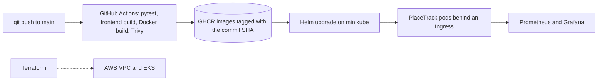

When I push to `main`, GitHub Actions runs the tests and builds the frontend. If both pass, it builds the two Docker images, scans them with Trivy and pushes them to GHCR tagged with the commit SHA. A deploy job on my laptop then runs Helm with that SHA on minikube, and the Ingress sends traffic to the new pods. Prometheus scrapes `/metrics` from the backend and Grafana draws the numbers. Terraform is separate: it builds the VPC and EKS cluster on AWS. I applied it once for the screenshots and destroyed it right after.

| Part | Tools |
|---|---|
| Frontend | React, Vite, nginx |
| Backend | FastAPI, SQLAlchemy, Alembic |
| Database | PostgreSQL |
| Tests | pytest, FastAPI TestClient, in-memory SQLite |
| CI/CD | GitHub Actions, GHCR, Trivy |
| Infrastructure | Terraform, AWS (VPC, EKS) |
| Deployment | Docker Compose, Kubernetes (minikube), Helm |
| Monitoring | Prometheus, Grafana |

```text
backend/            FastAPI app, migration, tests, Dockerfile
frontend/           React app, Dockerfile
docker-compose.yml  postgres, backend and frontend
.github/workflows/  CI/CD pipeline
terraform/          VPC and EKS
k8s/                namespace
helm/placetrack/    Helm chart
monitoring/         Prometheus and Grafana setup
scripts/            deploy and load test scripts
troubleshooting/    two broken manifests and how I fixed them
images/             screenshots
```

## Run it yourself

```bash
docker compose up --build      # app on http://localhost:3000, API docs on http://localhost:8000/docs
```

The tests need no database and no Docker:

```bash
cd backend
python3.12 -m venv .venv && source .venv/bin/activate
pip install -r requirements-dev.txt
pytest -v
```

## M1: Application with FastAPI, React and PostgreSQL

The backend is FastAPI and SQLAlchemy on PostgreSQL with one table, `jobs` (id, company, role, status, applied_on, notes). The table comes from the Alembic migration `backend/alembic/versions/0001_create_jobs.py` and not from the app, so Compose and Kubernetes both build the schema with `alembic upgrade head`. Pydantic checks the input: company and role must be 1 to 120 characters and status must be one of the four values, otherwise the API answers 422.

| Method | Path | What it does |
|---|---|---|
| GET | `/health` | Liveness check, returns `{"status":"ok"}` |
| GET | `/ready` | Runs `SELECT 1`, returns 503 if the database is down |
| GET | `/metrics` | Prometheus metrics |
| GET | `/api/jobs` | List applications, newest first, optional `?status=` |
| GET | `/api/jobs/stats` | Total and count per status |
| GET | `/api/jobs/{id}` | One application, 404 if missing |
| POST | `/api/jobs` | Create, returns 201 |
| PUT | `/api/jobs/{id}` | Update, 404 if missing |
| DELETE | `/api/jobs/{id}` | Delete, returns 204 |

The frontend is React with Vite. It shows the totals, a filter button for each status, and a table where I can add, edit and delete an application. It calls the API with `fetch` in `frontend/src/api.js`.

Files: `backend/app/`, `backend/alembic/versions/`, `backend/requirements.txt`, `frontend/`, `docker-compose.yml`.

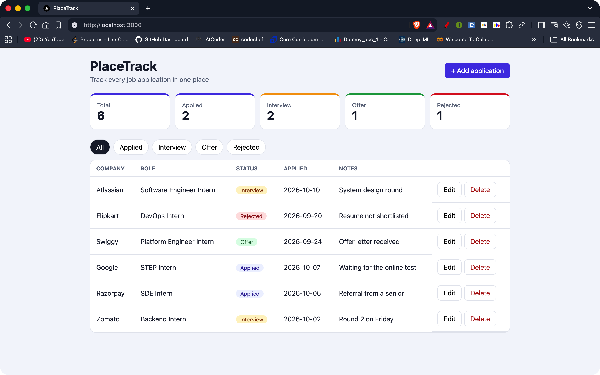

The app on http://localhost:3000 with a few applications added.

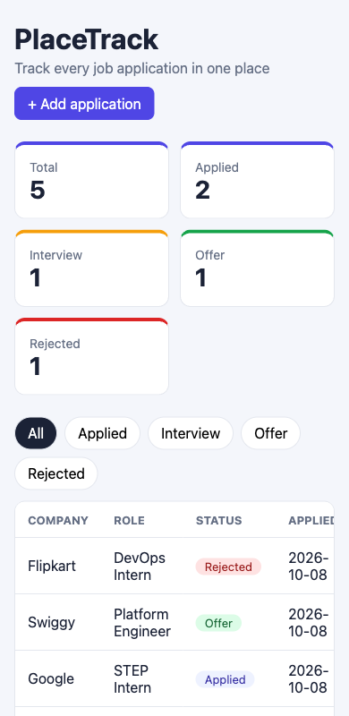

The same page on a narrow screen, where the Notes column is hidden.

## M2: Tests with pytest

I wrote 16 tests in `backend/tests/test_api.py`. They cover every endpoint (create, list with a filter, get, update, delete, stats, health, ready, metrics) and the bad cases: an invalid status or blank company gives 422, a missing id gives 404 on get, update and delete, and `/ready` gives 503 when the database is broken.

They never touch Postgres. `backend/tests/conftest.py` builds a fresh in-memory SQLite database for each test and swaps it in for the `get_db` dependency, and `backend/pytest.ini` sets the test folder and Python path. The tests create the table from the models, so the migration itself is run by Compose and the Helm job, not by pytest.

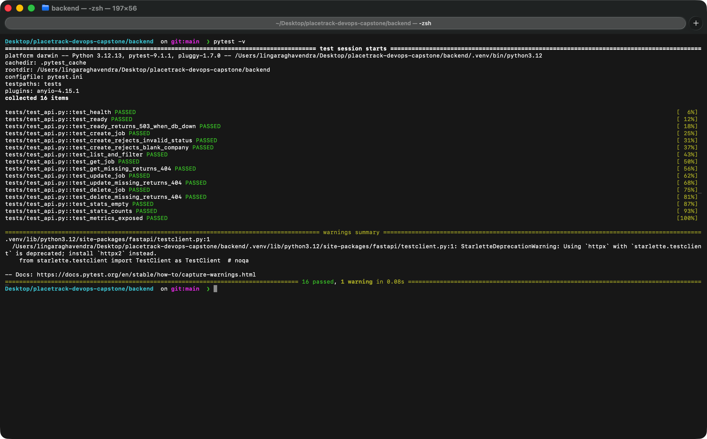

`pytest -v` in `backend/`, 16 passed.

## M3: Git and GitHub

The repository is public (link at the top). I worked in small commits and wrote what each one changes, for example "Add non-root Dockerfiles and docker-compose stack" and "Add jobs REST API, health/ready/metrics endpoints and pytest suite".

`.gitignore` keeps out `.env`, `__pycache__/`, `*.pyc`, `.venv/`, `node_modules/`, `dist/`, `.pytest_cache/`, `.terraform/`, `*.tfstate`, `*.tfvars` (but not `*.tfvars.example`) and the saved plan `tfplan`. There are no secrets in the repo: the Compose file has a throwaway local database password, the cluster passwords are generated at install time, and AWS credentials come from my AWS CLI profile. I ran Gitleaks over the whole history and it found nothing.

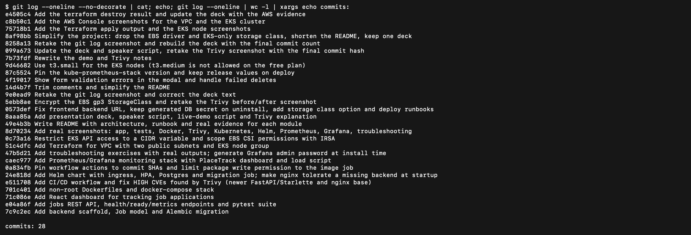

The commit list on GitHub.

## M4: Docker and Compose

Both images run as a normal user. The backend Dockerfile starts from `python:3.12-slim`, copies the code with `--chown` and sets `USER 10001`. The frontend Dockerfile has two stages: `node:20-alpine` runs `npm run build`, and only the built files are copied into `nginx-unprivileged`, which runs as user 101. A non-root nginx cannot use port 80, so it listens on 8080 and Compose maps that to 3000.

Compose starts three services. Postgres has a health check, the backend waits for it, runs `alembic upgrade head` and starts uvicorn, and the frontend nginx passes `/api` on to the backend. My first nginx config looked up the backend name only once at start-up, so now it resolves the name on every request and starts even when the backend is not up yet.

```bash
docker compose up --build      # open http://localhost:3000
```

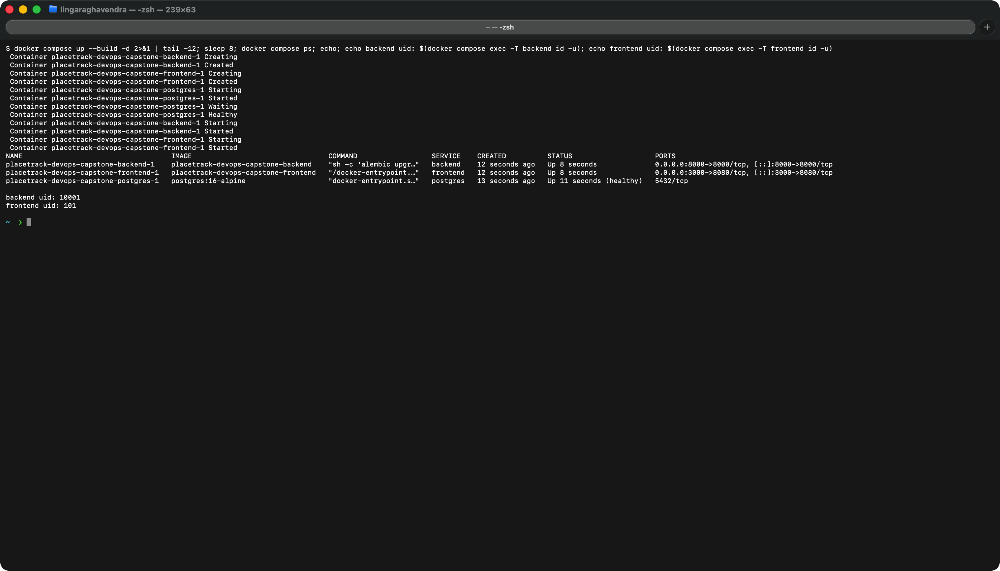

All three services up: postgres healthy, nginx for the frontend, uvicorn for the backend.


The app loaded in the browser at http://localhost:3000.

## M5: CI/CD with GitHub Actions

The workflow is `.github/workflows/ci-cd.yml`. It runs on every push to `main`, and on pull requests, which build and scan the images but never push them.

* `test`: runs `pytest -v` on Python 3.12. If a test fails, the job fails and nothing after it runs.
* `frontend`: Node 20, `npm ci && npm run build`.
* `image`: starts only when `test` and `frontend` passed. A matrix builds the backend and frontend images, Trivy scans each one, and each is pushed to GHCR.
* `deploy`: a Helm upgrade on minikube, explained below.

Every image is tagged with the full commit SHA and never with `latest`, so I always know which commit a pod is running:

```text
ghcr.io/raghavendra1729-cell/placetrack-backend:<commit SHA>
ghcr.io/raghavendra1729-cell/placetrack-frontend:<commit SHA>
```

For the green run the tag is `9e9a23c4224e15fc551af1d116050b544538aaa3`. I also pinned every action to a commit SHA, and only the `image` job may write packages.

The `deploy` job runs on a self-hosted runner on my laptop and calls `scripts/deploy.sh` with the new SHA. Because it needs my laptop, it only runs when the repository variable `DEPLOY_ENABLED` is `true`. Otherwise it is skipped and the rest of the pipeline stays green. The run linked at the top passed all five jobs: [Actions run](https://github.com/Raghavendra1729-cell/placetrack-devops-capstone/actions/runs/38878841957).

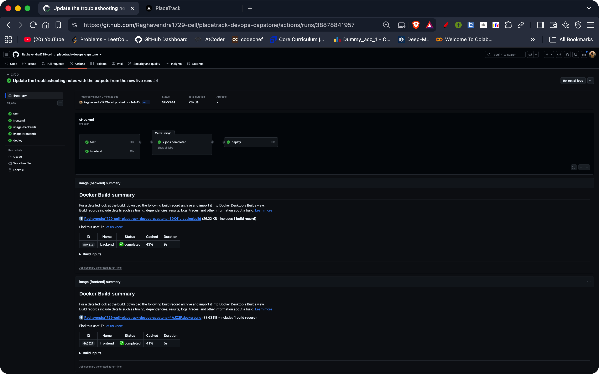

The run summary: test, frontend, both image jobs and deploy.

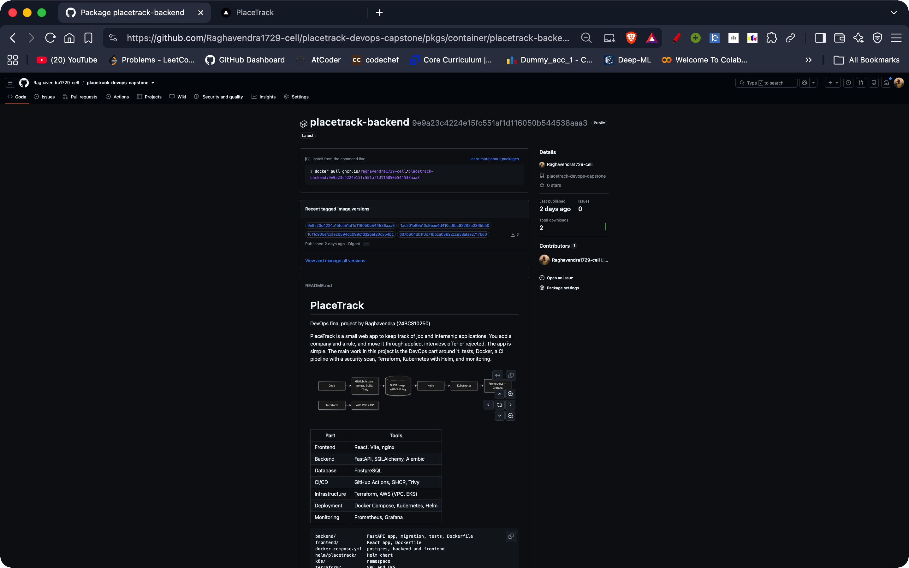

The backend package is public, with versions named by commit SHA.


The frontend package, tagged the same way.

## M6: Security scan with Trivy

After each image is built and before it is pushed, Trivy scans the finished image: the Debian and Python packages in the backend, the Alpine packages in the frontend. The step only looks at HIGH and CRITICAL findings, skips ones with no fix yet, and exits with code 1, so a fixable finding stops the pipeline before the push. In the green run both images show 0 findings. That means no known fixable HIGH or CRITICAL problem on that day, not that the image is safe forever, which is why the scan runs on every build.

My first scan failed. The backend had 3 HIGH findings in Starlette 0.41.3, for example CVE-2025-62727, where specially crafted `Range` headers can be used for a denial of service. My API does not serve files, so I do not think it could be hit in my app, but the version was flagged and the fix was only an upgrade. The old Alpine nginx image in the frontend had 42 HIGH and CRITICAL findings in OpenSSL, libexpat and libxml2. I upgraded FastAPI, which pulled in a newer Starlette, and moved the frontend to `nginx-unprivileged:1.30.5-alpine`. After that both images scanned clean.

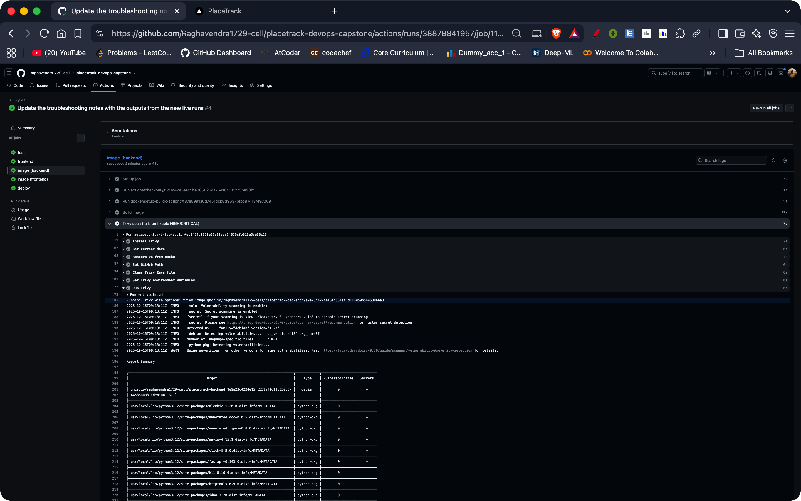

The backend scan in the pipeline: Debian 13.7 and the Python packages, 0 vulnerabilities.

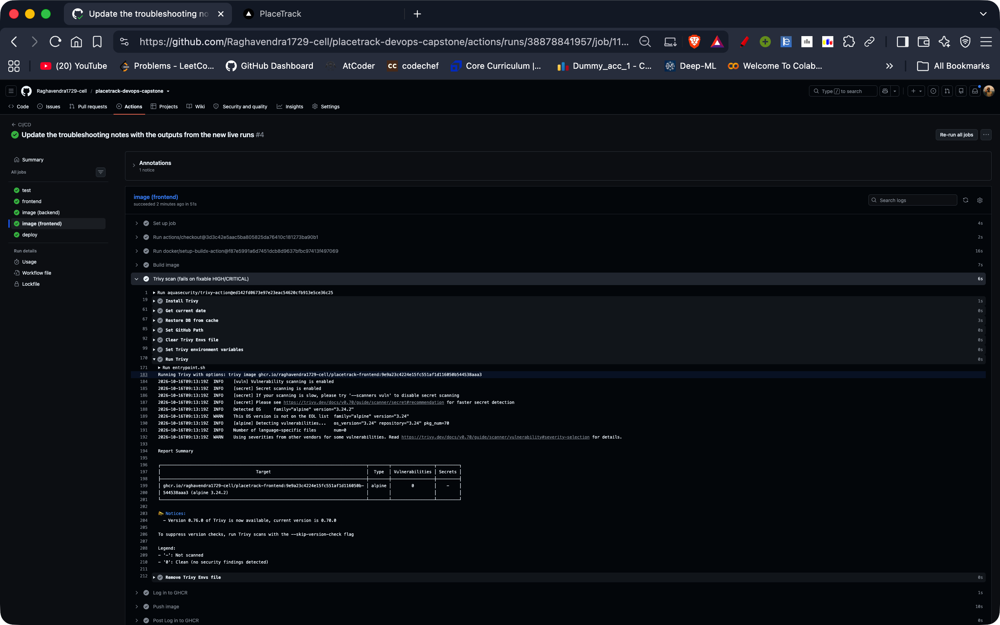

The frontend scan: Alpine 3.24.2, 0 vulnerabilities.

## M7: Terraform on AWS

The code is in `terraform/` (`main.tf`, `variables.tf`, `outputs.tf`, `versions.tf`), using the public VPC and EKS modules from the Terraform registry, in ap-south-1:

* A VPC with two public subnets in two availability zones. There is no NAT gateway because it costs money by the hour, so the nodes sit in the public subnets.
* An EKS 1.35 cluster with one managed node group of two `t3.small` nodes.
* The cluster API can only be reached from my own IP (`api_access_cidrs`).

Two choices came from problems. I first wanted `t3.medium` nodes but my AWS plan does not allow them, so I used `t3.small`. I picked Kubernetes 1.35 because 1.31 was already in paid extended support. `terraform.tfvars.example` is in the repo with a placeholder IP, and my own `terraform.tfvars` and the local state are git-ignored.

```bash
cd terraform
terraform init
terraform validate
terraform plan -out=tfplan
terraform apply tfplan          # about 15 minutes
terraform destroy
```

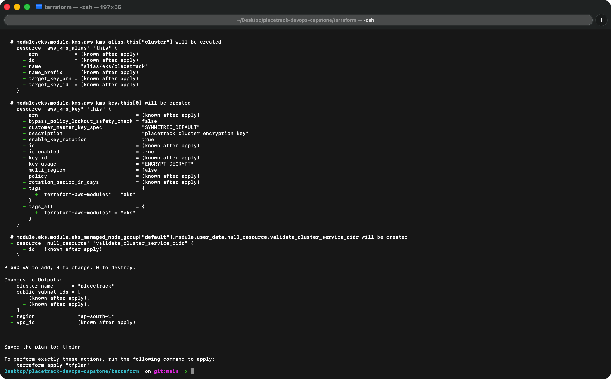

The plan: 49 to add, 0 to change, 0 to destroy.

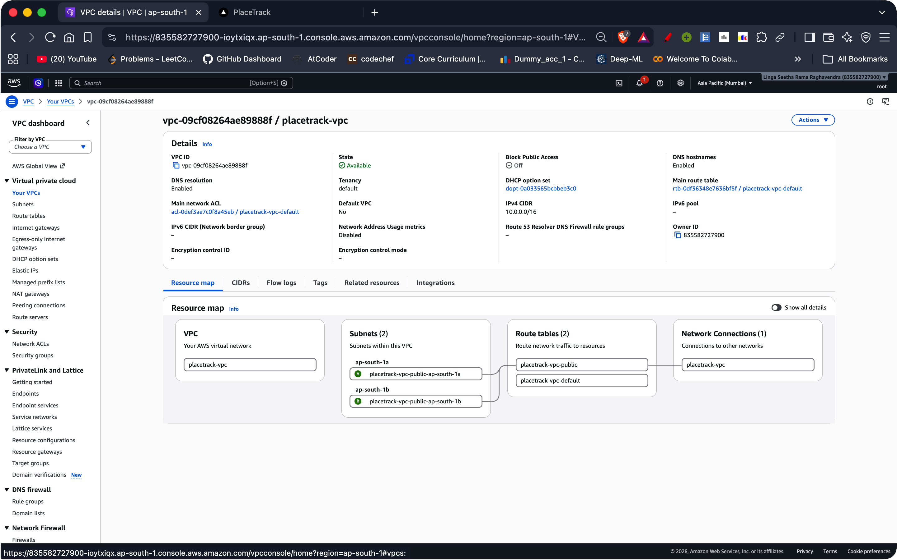

The VPC `placetrack-vpc` in Mumbai with public subnets in ap-south-1a and ap-south-1b.

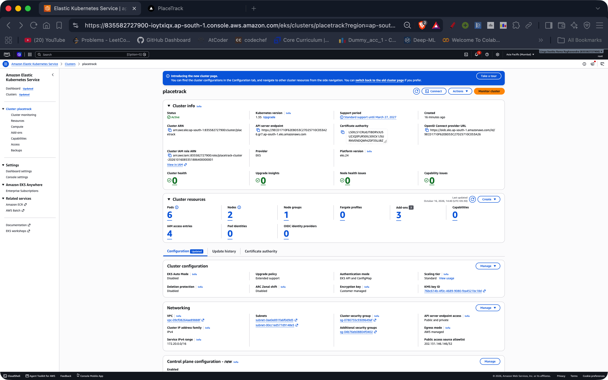

The cluster `placetrack`, Active, on Kubernetes 1.35.

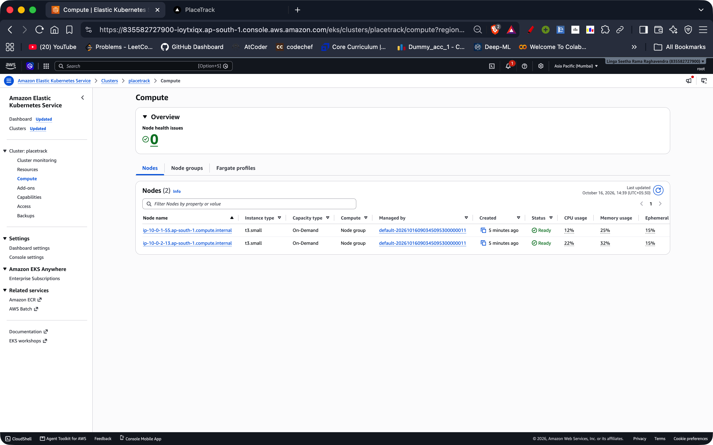

The two `t3.small` nodes, both Ready.

EKS costs money every hour, so after the screenshots I ran `terraform destroy`.

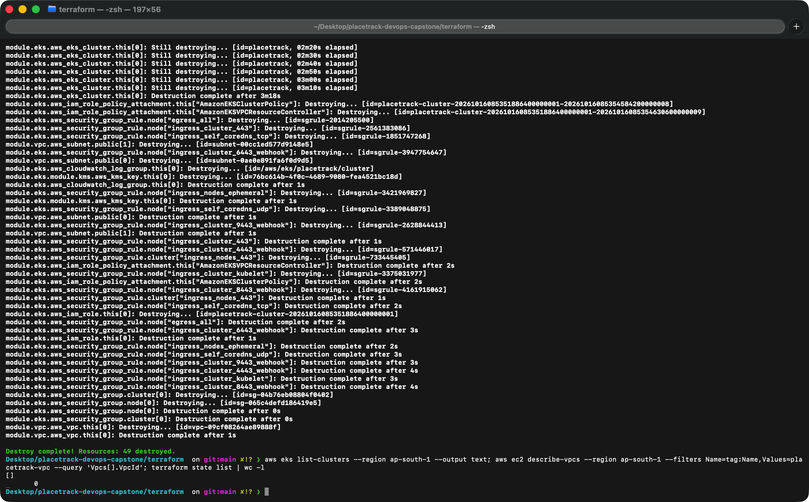

Destroy complete with 49 destroyed, then a check that no cluster, VPC or Terraform state is left.

## M8: Kubernetes and Helm

I packed the app into a Helm chart, `helm/placetrack`, with `Chart.yaml`, `values.yaml` and these templates:

* `backend.yaml` and `frontend.yaml`: a Deployment with 2 replicas and a ClusterIP Service each, with resource limits and probes, running as a non-root user.
* `postgres.yaml`: Postgres as a StatefulSet with a 1Gi volume.
* `secret.yaml`: a database password generated at the first install and kept on upgrades.
* `migrate-job.yaml`: a Job that runs `alembic upgrade head` after every install and upgrade.
* `ingress.yaml`: host `placetrack.local`, `/` to the frontend and `/api` to the backend.
* `hpa.yaml`: scales the backend between 2 and 4 pods at 60% CPU.
* `servicemonitor.yaml`: used in M9.

The namespace is `k8s/namespace.yaml`. To keep the AWS bill low I ran the chart on minikube on my laptop, with the images the pipeline pushed to GHCR. With the Docker driver on a Mac the minikube IP is not reachable from the host, so I forward the ingress controller to port 8080 and added `127.0.0.1 placetrack.local` to `/etc/hosts`.

```bash
minikube start -p placetrack --driver=docker --cpus=4 --memory=5500
minikube -p placetrack addons enable ingress
minikube -p placetrack addons enable metrics-server
kubectl apply -f k8s/namespace.yaml
helm upgrade --install placetrack helm/placetrack -n placetrack --set image.tag=<commit SHA> --wait
kubectl -n ingress-nginx port-forward svc/ingress-nginx-controller 8080:80      # open http://placetrack.local:8080
```

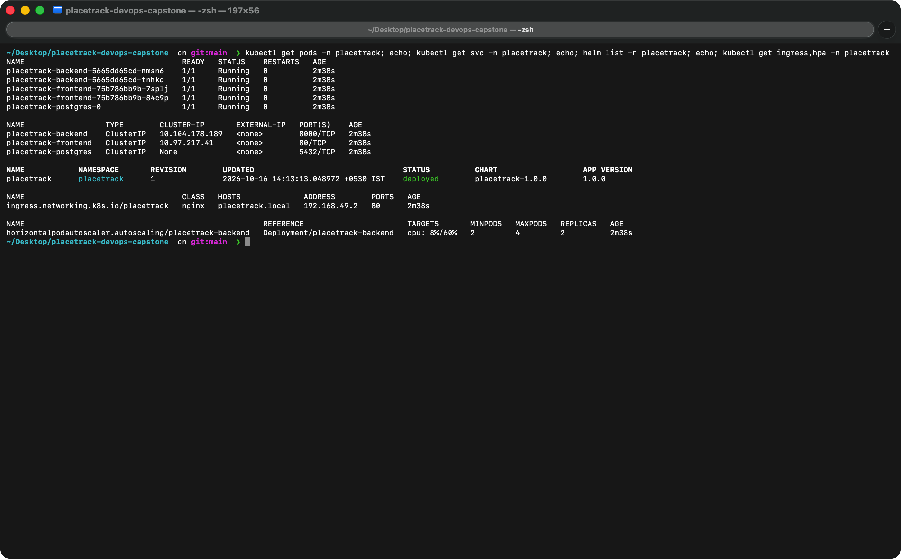

`kubectl get pods -n placetrack` (2 backend, 2 frontend, Postgres, all Running), `kubectl get svc -n placetrack` (ClusterIP), `helm list -n placetrack`, the Ingress and the HPA.

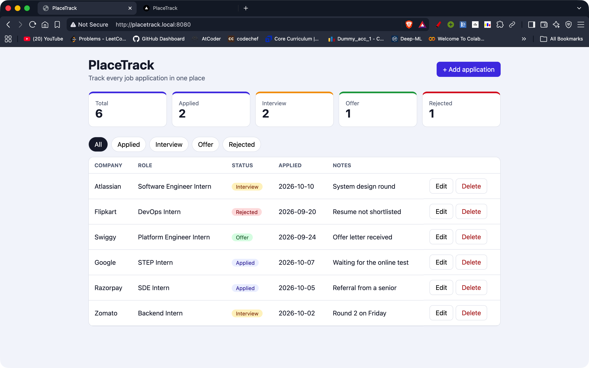

The app in the browser at http://placetrack.local:8080, through the Ingress.

When I ran `scripts/load-test.sh`, CPU went above the 60% target and the HPA added a third backend pod.

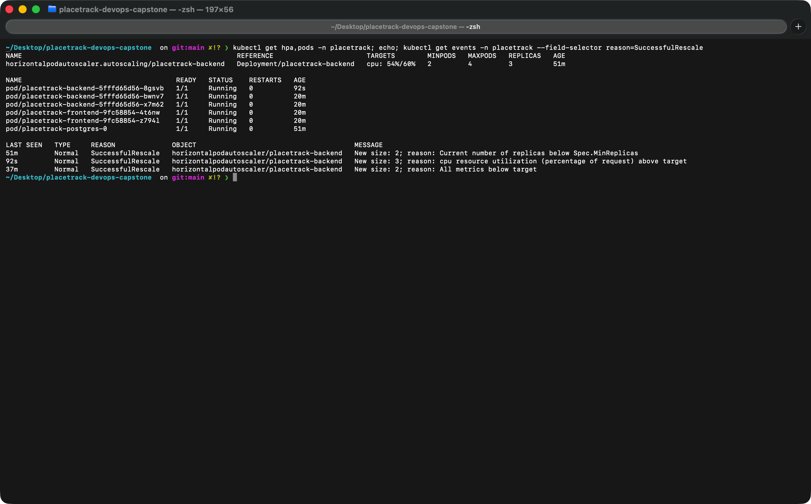

The HPA with 3 replicas and the `SuccessfulRescale` event.

## M9: Monitoring with Prometheus and Grafana

The backend exposes `/metrics` with `prometheus-fastapi-instrumentator`, which counts requests (`http_requests_total`) and times them per endpoint. `monitoring/install.sh` installs the kube-prometheus-stack chart (version pinned) with `monitoring/values.yaml` and loads my dashboard from `monitoring/grafana-dashboard.json`. The values file keeps only 6 hours of data for my small cluster and turns Alertmanager off. The Grafana password is generated by the install script.

The ServiceMonitor in my chart tells Prometheus to scrape `/metrics` on the backend pods every 15 seconds. It is off by default because that resource type only exists after the monitoring chart is installed, so I switch it on afterwards. The dashboard has four panels: requests per second per endpoint, p95 latency, error responses per second and the number of backend pods up. My load script only requests jobs that exist, so the error panel stays at zero.

```bash
./monitoring/install.sh
helm upgrade placetrack helm/placetrack -n placetrack --reuse-values --set serviceMonitor.enabled=true
./scripts/load-test.sh http://localhost:8080 60
```

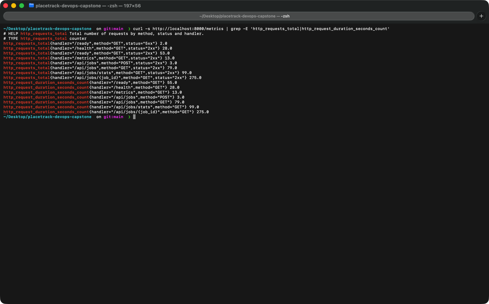

`curl http://localhost:8000/metrics` on the backend, filtered to the request counters.

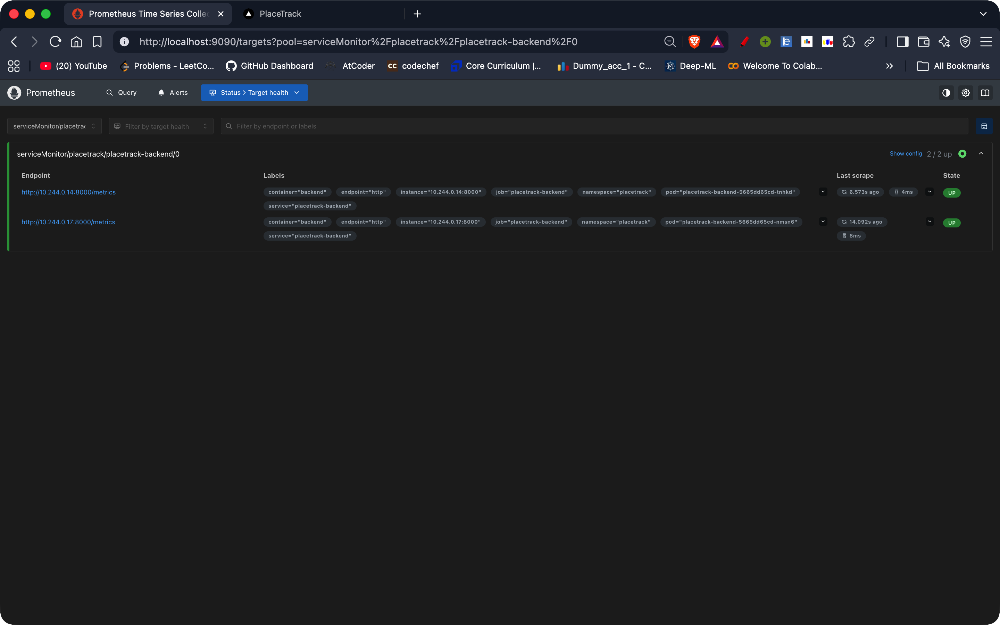

The Targets page: `serviceMonitor/placetrack/placetrack-backend/0`, both backend pods UP.

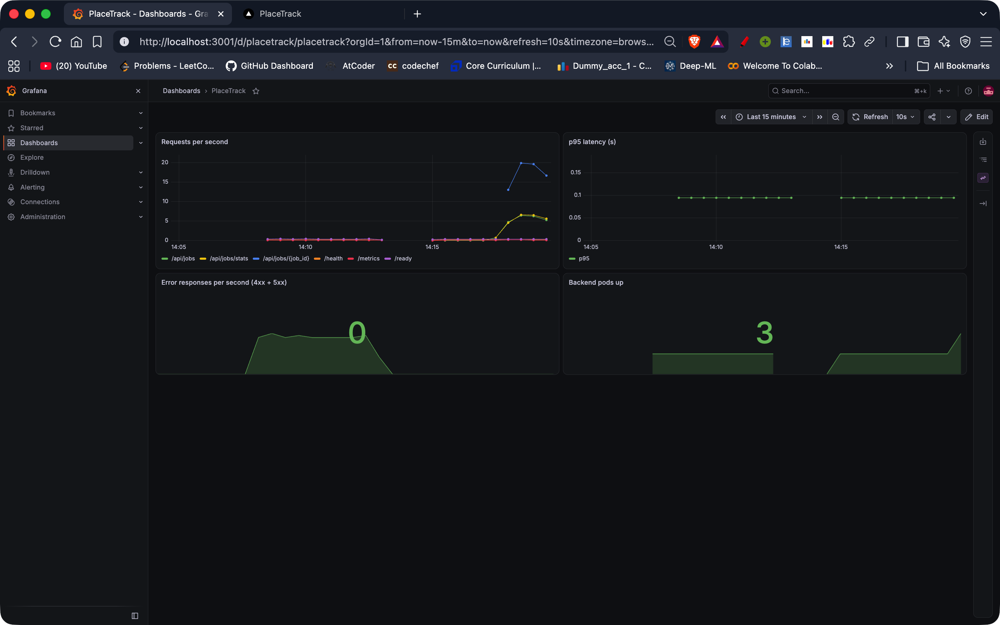

The PlaceTrack dashboard during the load test, with 3 backend pods because the HPA had just scaled up.

## Troubleshooting

I broke two things on purpose to practise, and fixed both in five steps: identify, investigate, root cause, fix, verify.

* Wrong image tag (`broken-image.yaml`): the pod stayed in `ErrImagePull` and then `ImagePullBackOff`, because the tag `does-not-exist` is not in GHCR. I pointed the Deployment at a tag the pipeline had pushed.
* Wrong Service selector (`broken-service.yaml`): the pod was Running but the Service had no endpoints, because it selected `app=tb-service` and the pod was labelled `app=tb-svc`. I patched the selector.

The commands and output are in [troubleshooting/README.md](troubleshooting/README.md).

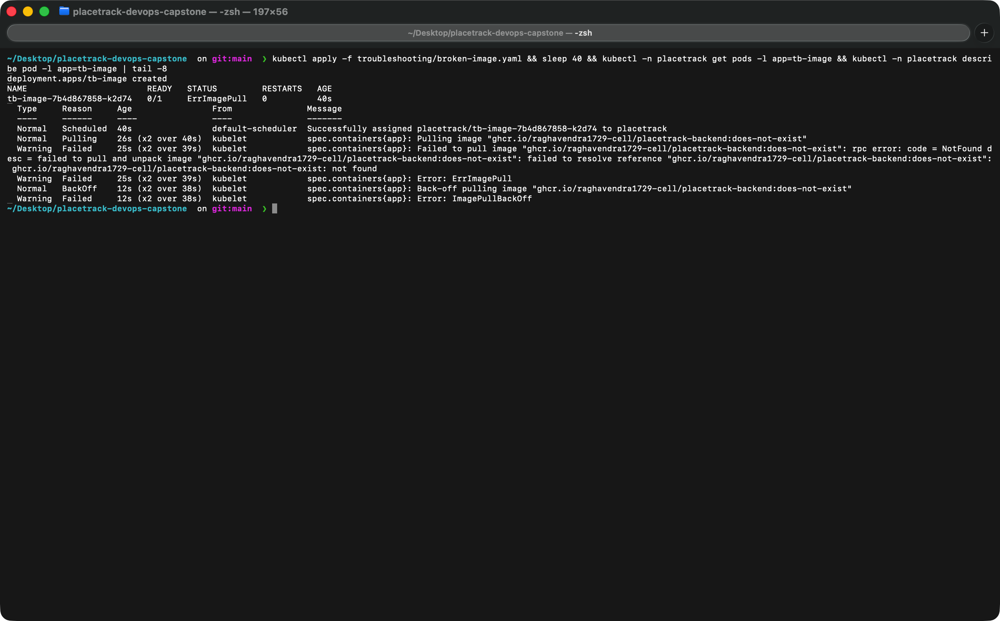

The bad image tag: `ErrImagePull` and the events from `kubectl describe pod`.

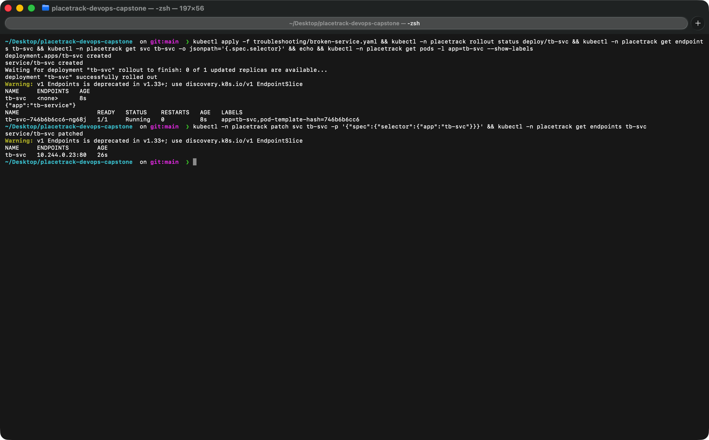

No endpoints, the two different labels, and the endpoint after the patch.

## M10: Live demo

This README and my presentation ([Google Slides](https://docs.google.com/presentation/d/1nObb-1njzx3Gw9raF8tN1dGPw5M0CGrD/edit?usp=sharing) or [PlaceTrack-Capstone.pptx](PlaceTrack-Capstone.pptx)) explain what I built. For the demo I change the app, push it and watch the pipeline deploy it. Before I start, minikube is running, the self-hosted runner on my laptop is online, the ingress port-forward from M8 is open, and I turn on the repository variable `DEPLOY_ENABLED` (set to `true`).

1. Open the app at `http://placetrack.local:8080`.
2. Change the subtitle in `frontend/src/App.jsx` ("Track every job application in one place"), then `git commit` and `git push` to `main`.
3. Open GitHub Actions. `test` and `frontend` run first, then `image` builds, scans and pushes both images, then `deploy` starts.
4. The `deploy` job runs `scripts/deploy.sh` with the commit SHA. It applies the namespace, runs `helm upgrade --install` with `image.tag` set to that SHA, and waits for both Deployments to roll out.
5. In another terminal, `kubectl -n placetrack get pods -w` shows the new pods starting and the old ones terminating.
6. Refresh the browser and the new subtitle is there.

## What I learned

* A build that passes can still be insecure. Trivy failed my first images even though everything worked.
* nginx looks up the backend name only once when it starts, and its resolver does not use the Kubernetes search domains. I got a 502 until I used the full name `<service>.<namespace>.svc.cluster.local`.
* A pod can be Running but not Ready. My backend pods stayed at 0/1 until they could reach Postgres, because `/ready` checks the database.
* The database password Secret has to survive `helm uninstall`, because the Postgres volume still has the old password.
* The cluster passwords (database and Grafana) are generated at install time and never committed.
* Cloud cost is part of the design. I ran EKS only long enough for the screenshots and used minikube for the rest.

If I had more time I would run the Helm chart on the EKS cluster for longer, because I never deployed the app there. I would also turn Alertmanager back on with an alert for a high error rate or no backend pod being up, and run the tests against Postgres in CI so the migration is tested too.
